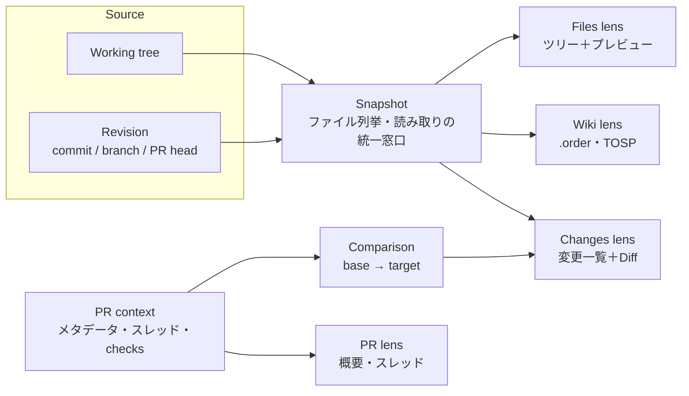

# ドキュメント・PR閲覧エクスプローラ 概念設計

- Status: Draft（概念設計）
- Date: 2026-10-25（2026-10-31 改訂: 実装基盤を Rust / Ratatui に変更。名前を replor とし、新規リポジトリ halkn/replor で作る）
- ツール名: replor（リポジトリ halkn/replor。旧 Go 実装は halkn/replor-go にリネームしてアーカイブする）
- 実装基盤: Rust（2024 edition） / Ratatui / Crossterm
- 先行資産: halkn/mdvu（Rust、v0.10.2。描画パイプライン）、halkn/docsail（Rust、v0.4.0。ワークスペースのナビゲーション）、旧 replor（halkn/replor-go。Go。設計文書 docs/plans/initial/DESIGN.md v0.3）
- 参考: persiyanov/herdr-reviewr v0.48.0

## Why

旧 replor（Go）は「ローカルのファイル・ドキュメント・Git変更をターミナルで閲覧する」ツールとして設計した。実装を進めた結果、ローカル変更のレビューは herdr-reviewr と大きく重複していることが分かった。herdr-reviewr は自分（とエージェント）の作業ループ、つまり未コミット差分・ラストターン差分の確認と、行コメントのエージェントへの返送に最適化されている。この用途は herdr-reviewr で十分に満たせる。

一方で、次の2つは herdr-reviewr の対象外であり、現状のツールでは満たせていない。

1. 他人の PR を、手元の作業ツリーを切り替えずにターミナルでレビューする。herdr-reviewr の PR タブは現在のブランチに紐づく PR を読み取り専用で表示するだけで、任意の PR を選んで差分を読む機能はない。
1. Azure DevOps Wiki を含むドキュメントを、Mermaid と画像を含めて、ワークスペースとしてたどりながら閲覧する。mdvu は1ファイルだけを表示し、docsail はワークスペースを扱うが描画が mdvu より弱く、どちらも PR を扱わない。

そこで、本ツールは「他人が書いたもの（ドキュメント・Wiki・PR）を読む」ことを中心に据えたエクスプローラとして再定義する。ファイルエクスプローラとプレビュー（Mermaid・画像を含む）を基本機能とし、その上に差分表示と PR 表示を載せる。描画は mdvu のパイプラインを、ナビゲーションは docsail の設計を引き継ぐ。

本ツールの価値はターミナルの中で完結することにある。ブラウザで読むなら、Wiki は Azure DevOps Wiki の Web UI、PR は GitHub・Azure DevOps の PR 画面で足り、本ツールが加えるのは「ローカルのクローン・未 push の内容を読める」ことだけになる。

### 却下した案

| 案 | 却下理由 |
|---|---|
| TS / Bun / OpenTUI で実装する | 個人開発の既定は Rust であり、TS でしか満たせない要件がない。OpenTUI の Image・Diff・Markdown・Code の各 Renderable は実装量を減らすが、Rust で満たせない要件ではない。mdvu・docsail の Rust 資産（日本語の禁則、Azure Wiki 方言、merman と resvg による Mermaid の画像化、kitty の画像描画）を捨てることになる |
| 旧 replor（Go）をそのまま継続 | ローカル変更レビューの比重が高く、herdr-reviewr と重複する。個人開発の既定は Rust である |
| docsail のコードを土台に拡張 | 描画は mdvu が上回る（禁則・表・Azure 方言・画像の切り出し・snapshot テスト）。docsail は merman の `raster` feature で Mermaid を画像化しており、図中の画像が指すローカルファイルを content root の外でも読む（mdvu `docs/mermaid-image.md` で merman 0.7.0 について確認済み）。`workspace.rs` はファイルシステムを直接読み、リビジョンを Snapshot として扱うには作り替えが要る。ナビゲーションの設計（`.order`、ツリーの Git status 列、`docs/` 優先の起動）は引き継ぐ |
| herdr-reviewr の拡張・fork | 設計がエージェントとのレビューループ（Send・last turn・コメント保持）を中心に組まれている。Wiki・Mermaid・任意 PR の閲覧はその責務から外れ、upstream に入る見込みが低い（推測） |
| Web UI（Rust ＋ htmx 4 のローカルサーバー＋ブラウザ） | ブラウザ版は Azure DevOps・GitHub の Web UI と重複し、ターミナルで完結するという本ツールの価値がなくなる。ただし、普段の環境（macOS の Ghostty、WSL＋Noctty または WezTerm、それぞれの中の herdr）で画像が表示できず、Mermaid がテキスト図かソースでしか読めない場合は、この案に切り替える（P0 Spike の判定基準） |

## What

### プロダクトステートメント

> ローカルのリポジトリ／Wiki クローンで起動し、作業ツリーまたは任意のリビジョン（PR の head を含む）を、同じエクスプローラとプレビューで閲覧できるターミナルツール。PR は作業ツリーを切り替えずにレビューできる。将来は、1ファイルを指定すれば mdvu と同じ単一ファイルのビューアとして動く（mdvu の統合。v1 の対象外）。

### 原則

1. **Reader-first**: 自分の作業ではなく、他人が書いたものを読むことに最適化する。自分の作業のレビューは herdr-reviewr に任せる。
1. **No checkout**: PR のレビューで作業ツリー・index・ユーザーのブランチを変更しない。PR の内容は Git オブジェクトから直接読む。
1. **Local-first**: ファイル・Wiki 閲覧はネットワークと認証なしで動く。ネットワークを使うのは PR 一覧・メタデータの取得と、明示操作による fetch だけ。
1. **Same view for every source**: 作業ツリーでも PR head でも、ツリー・プレビュー・Wiki ナビゲーションは同じものを使う。
1. **Graceful degradation**: 画像 protocol が使えない端末・multiplexer では、Mermaid はテキスト図かソース、画像は代替テキストで表示する。Mermaid を半ブロックの画像にはしない（docsail で図中の文字が読めないことを確認済み）。キー操作は変えない。
1. **Inert rendering**: 描画コアは文書の内容を実行せず、サブプロセス・ネットワークを使わない（mdvu の原則を描画コアに限って引き継ぐ）。git・`gh`・`az` を呼ぶのはアプリ層だけとする。

### 中心概念

本ツールの中心は「Snapshot（何を見るか）」と「Lens（どう見るか）」の2軸である。PR レビューは「PR head の Snapshot を、PR の Comparison を重ねて閲覧すること」として表す。PR 専用の閲覧画面を別に作らない。

| 概念 | 定義 |
|---|---|
| Snapshot | 閲覧対象のファイル集合。作業ツリー、またはリビジョン（commit OID）のどちらか。ファイル列挙・読み取りはすべて Snapshot を経由し、ビューは作業ツリーかリビジョンかを意識しない。Markdown 中の画像の解決も Snapshot を経由する |
| Comparison | base と target の組。target は Snapshot。PR の場合、base は PR の対象ブランチと PR head の merge-base、target は PR head |
| PR context | プロバイダーから取得した PR のメタデータ（タイトル・説明・状態・checks・レビュー・スレッド）。Comparison の base/target を決める根拠になる |
| Lens | Snapshot をどう見せるか。Files / Wiki / Changes / PR の4種。左ペインで切り替える |
| Preview | 1ファイルの表示。Markdown（Mermaid・画像を含む）、コード、画像、テキスト。Snapshot 上の任意のファイルに使える。mdvu を統合した後の単一ファイルモードは、Lens を持たない Preview だけの画面とする |

### 主要ユースケース

1. Azure DevOps Wiki のクローンで起動し、`.order` の順序でページをたどり、Mermaid と添付画像を見る。
1. リポジトリの README・設計書を、相対リンクと TOC でたどって読む。
1. PR 一覧から他人の PR を選び、作業ツリーをそのままにして、変更ファイル一覧と Diff を読む。
1. PR に含まれる設計書（Markdown）を、Diff ではなくレンダリング結果（Mermaid・画像を含む）で読む。PR head の任意のファイルもエクスプローラで開ける。
1. PR の説明・checks・既存のレビュースレッドを読み、必要ならブラウザで PR を開く。
1. 自分の作業ツリーの未コミット変更を、ツリー上の status マークと Diff で軽く確認する（詳細なレビューは herdr-reviewr）。
1. （mdvu の統合後）1ファイルを単体で読む。エージェントが編集中の文書を `--watch` で追う、fzf のプレビューに stdout へ描画する、`git show <rev>:<path>` を stdin から読む（mdvu の用途）。それまでは mdvu を使う。

### herdr-reviewr との対応

| herdr-reviewr の機能 | 本ツールでの扱い | 理由 |
|---|---|---|
| Changes / All files / PR の3タブ | Files / Wiki / Changes / PR の4 Lens に再編 | Wiki を第一級にする。All files は Snapshot 上の Files lens に一般化する |
| uncommitted / branch スコープ | 作業ツリーに対する Comparison として残す（最小限） | ツリーの status 表示と軽い確認に使う |
| last turn スコープ | 採用しない | エージェント連携は herdr-reviewr の責務 |
| commits スコープ（範囲選択） | Revision Snapshot ＋ Comparison で表現できる。v1 では PR に限定 | PR 以外の任意範囲は需要が出てから |
| 行コメント・Send・Copy | 採用しない | エージェントへの返送は対象外。PR へのコメント投稿は Open Questions |
| PR タブ（現在ブランチの PR） | 任意の PR を一覧から選べるように拡張。差分は PR head を fetch して閲覧 | 他人の PR レビューが中心のため |
| unified / split 表示、ハンク移動 | 採用する。Diff は自前で描画し、herdr-reviewr（Rust）の実装を参考にする | PR レビューで必要。Ratatui には OpenTUI の DiffRenderable に相当する部品がない |
| Markdown のレンダリング表示と変更マーク | 採用する。レンダリング表示に Mermaid・画像を含める | ドキュメント PR のレビューに必要 |
| ファイル名・内容検索（fff） | ファイル名のファジー検索を採用。内容検索は Open Questions | |
| No writes 不変条件（private ref と private index だけ書く） | 同等の不変条件を置く（Constraints） | PR の fetch でオブジェクトと private ref を書く必要がある |
| Continuity 不変条件（位置状態はユーザー操作でだけ動く） | 採用する | 再取得・監視で閲覧位置が飛ばないようにする。mdvu の `--watch` はソース行で閲覧位置を保っており、これを引き継ぐ |
| テーマ20種、エディタ起動 | v1 の対象外 | 閲覧の中核ではない |

### mdvu から引き継ぐもの（コード）

mdvu の次の部分は、P1 でコードを replor にコピーし、描画コアの crate とする。取り込み元の mdvu のコミット SHA を replor 側に記録する。コピーした後、mdvu は機能を追加せず、不具合の修正だけを行う。replor 側で直した不具合は mdvu に戻さない（mdvu は統合時にアーカイブする）。

`markdown/`・`layout/` は `ratatui` に依存しない（`markdown/model.rs`・`layout/mod.rs` の冒頭で明記されている）。`image/mod.rs` は `crossterm::terminal::window_size` を呼ぶ。

- `markdown/`: renderer-neutral な IR。すべての block が `SourceRange`（byte 範囲と1始まりの行）を持つ。
- `flavor/`: Azure DevOps Wiki 方言（`[[_TOC_]]`、`::: mermaid`、`
`、`#123`、`@alias`、`.attachments/`、未終端 `:::` の扱い）。
- `diagram/`: merman（`ascii`・`render`）による Mermaid のテキスト図と SVG、resvg による PNG 化。href を解決しない resolver で図中の画像を読まない。
- `layout/`: 表示幅と JIS X 4051 の禁則による折り返し、表の列幅、syntect による構文ハイライト。
- `image/`・`pager/images.rs`: kitty（格納1回・配置の置き換え・上下端の切り出し）と iTerm2 の描画、content root を出ない画像パスの解決。
- `pager/`: 描画結果の検索、見出し一覧、`--watch` での閲覧位置の保持。
- `tests/render.rs` の insta snapshot と `docs/`（rendering.md・runtime.md・mermaid-image.md）の決定事項。

### docsail から引き継ぐもの（設計と一部のコード）

- Mermaid の検証結果と描画境界（docsail ADR-0004）: 半ブロック表示は図中の文字が読めないため使わない。backend を小さな境界の背後に置く。
- 画像 protocol の検出: `ratatui-image` の `Picker::from_query_stdio` で端末に問い合わせ、失敗時は halfblocks を返す（`main.rs`）。mdvu は環境変数だけで判定し sixel を持たない。普段の端末はどれも kitty か iTerm2 の protocol を持つので mdvu の方式を第一候補とし、mdvu の方式が表示できない環境があったときだけ ratatui-image と比べる（P0 Spike）。
- herdr 経由の画像表示: macOS の Ghostty 上の herdr では `experimental.kitty_graphics = true` が必要。WSL の中で動く herdr での Kitty graphics は未検証。
- ツリーの Git status 表示: 行頭に porcelain と同じ2文字の状態列（1文字目 staged、2文字目 unstaged）を置き、配下に変更があるディレクトリと子ページを持つページには集約マーク `•` を付ける。
- 起動対象の推定: 引数なしのとき `docs/` があればそれを優先して開く。
- `.order` によるページ順序（未指定ページは末尾の名前順）、子ページを持つ Wiki ページの折りたたみ・展開、相対 Markdown リンク・GitHub 互換の見出しアンカー・Back / Forward（docsail v0.2.0 のスコープ）。
- `.gitignore` を考慮した探索（docsail ADR-0005、`ignore` crate）。

### 旧 replor（halkn/replor-go）から引き継ぐもの（設計）

コードは引き継がない（Go）。

- Git 実行契約（旧 replor の DESIGN.md 7.3）: optional locks・autoRefreshIndex・fsmonitor・filter driver・external diff/textconv・pager・対話認証・環境変数の許可リスト。素の `git diff` が index を書き戻すことや外部プログラムを起動することを、旧 replor の P0 で実測済み（ADR-0001）。
- Azure Wiki の方言のうち、ナビゲーションに関わる規則（旧 replor の DESIGN.md 8.2）: `[[_TOSP_]]`、ページ名とファイル名の変換、root 相対リンク、拡張子なしリンクの解決規則。
- 見出し ID の規則（github-slugger 互換）と、その fixture（旧 replor の `testdata/github-slugger`）。
- Azure Wiki の合成 fixture（旧 replor の `testdata/azure-wiki`）。
- Workspace 境界（symlink・パス逸脱の拒否）、外部 URL の扱い（明示操作・http/https のみ）、端末制御文字の無害化（旧 replor の DESIGN.md 6.1・11）。

### 既存ツールの整理

| ツール | 扱い |
|---|---|
| 旧 replor（Go） | halkn/replor-go にリネームしてアーカイブする。設計文書と fixture は参照用に残す |
| replor（新規） | halkn/replor として新規に作る。P1 で mdvu の描画コードをコピーして取り込む |
| mdvu | 当面は独立した単一ファイルのビューアとして残し、機能を追加しない。replor に単一ファイルモードを入れた時点（P5）でアーカイブする |
| docsail | replor が Files lens と Wiki lens で docsail の機能に追いついた時点（P2）でアーカイブする |

mdvu のリポジトリを土台にする案（halkn/mdvu を halkn/replor にリネームする）は採らない。mdvu の統合を後に回すため、mdvu を単体のツールとして残す。描画コードの履歴は mdvu のリポジトリで参照できる。

## Scope

### v1 の対象

| 区分 | 内容 |
|---|---|
| Explorer | 作業ツリーのファイルツリー、ファジーファイル検索、履歴（戻る・進む）、Git status マーク |
| Preview | Markdown（GFM）、コード（構文ハイライト）、テキスト、画像。Preview / Source の切り替え |
| Mermaid | Markdown 中の Mermaid を、画像対応端末では画像、非対応端末ではテキスト図またはソースで表示。最低限の図種は flowchart・sequence・ER |
| Wiki | Azure DevOps Wiki 方言（mdvu の `flavor/` と旧 replor の DESIGN.md 8.2 の範囲） |
| Links | 相対リンク・アンカー・TOC。外部 URL は明示操作でブラウザに渡す |
| Diff | unified / split 表示、ハンク間移動、Markdown のレンダリング表示と変更マーク |
| Local changes | 作業ツリーの uncommitted / branch の変更一覧と Diff（最小限） |
| PR | GitHub と Azure DevOps の PR 一覧・選択、PR head の fetch、PR head Snapshot の閲覧、PR の変更一覧と Diff、PR の説明・状態・checks・レビュースレッドの読み取り専用表示、ブラウザで PR を開く |

### Out of scope（v1）

- PR へのコメント投稿・承認・マージ（Open Questions Q1 で再判断）
- エージェントへのコメント返送、last turn スコープ
- 作業ツリー・index・ユーザーのブランチを変更する Git 操作（checkout、stage、commit、push）
- Issue・Work Item・Pipeline の閲覧
- Wiki の Azure DevOps API 経由の取得（Wiki はローカルクローンを読む）
- 全文検索インデックス、エディタ機能
- GitLab（herdr-reviewr は対応しているが、利用先がないため）
- Web UI
- 単一ファイルモード（mdvu の統合。P5）

## Constraints

- 実装は Rust（2024 edition）、Ratatui、Crossterm。検証は `cargo fmt --check`、`cargo clippy --all-targets --all-features -- -D warnings`、`cargo test --all-features` とし、CI を正とする（mdvu と同じ）。
- 描画コア（mdvu から取り込む部分）は crate として分け、git・`gh`・`az`・サブプロセス・ネットワーク・Ratatui に依存させない。ファイルの読み取りは Snapshot の trait を経由させ、作業ツリーとリビジョンで同じコードが動くようにする。
- 描画に Node.js、Chromium、WebView、外部コマンドを使わない。JavaScript engine を含む crate を入れない（mdvu の方針）。
- 作業ツリー、index、ユーザーのブランチ・タグ、ユーザーの Git 設定を変更しない。書いてよいのは、明示操作による fetch が作る Git オブジェクトと、本ツール専用の ref 名前空間（例: `refs/<tool>/`）だけとする。fetch は自動で実行しない。
- Git の呼び出しには旧 replor の DESIGN.md 7.3 の実行契約を適用する。
- PR プロバイダーへのアクセスは、ユーザーがログイン済みの `gh` / `az`（azure-devops 拡張）を経由する。本ツールは認証情報を保存しない。
- 外部ブラウザの起動、URL の検査、端末制御文字の無害化は旧 replor の DESIGN.md 11 と同等の境界を守る。
- Markdown のナビゲーション索引（見出し・アンカー・リンク・ソース位置）は IR から作り、描画結果の文字列から作らない。
- Mermaid の描画は小さな境界（要求・結果・エラー）の背後に置き、merman と resvg への接触面をそれぞれ1 module に限る（mdvu の `diagram/mermaid.rs`・`diagram/raster.rs`）。

## 技術上の前提とリスク

| 項目 | 前提 | 確度 |
|---|---|---|
| 画像表示（mdvu 方式） | kitty と iTerm2 を自前で描く。判定は環境変数（`TERM`・`TERM_PROGRAM`・`KITTY_WINDOW_ID`・`KONSOLE_VERSION`）だけで、端末に問い合わせない。kitty・Ghostty・WezTerm は kitty protocol、iTerm2 は iTerm2 protocol を選ぶ。sixel は実装していない。tmux 配下では既定で off | mdvu の README・`docs/runtime.md` で確認 |
| 画像表示（ratatui-image） | sixel・kitty・iTerm2 を扱い、環境変数で推定できなければ端末に問い合わせ、だめなら halfblocks に落とす。互換表では、WezTerm は kitty と sixel も持つが不具合なく動くのは iTerm2 protocol だけとしている | ratatui-image 11.1.0 の README で確認 |
| Noctty（WSL） | Ghostty の terminal core を使う Windows 向け端末（旧 winghostty）。Kitty graphics を表示できるが、sixel は ConPTY を通すだけで描かない。Kitty の画像は OpenGL renderer が要り、OpenGL 4.3 が使えない環境（リモートデスクトップ、3D アクセラレーションのない VM）で自動で切り替わる Direct3D 11 renderer では描かれない。`wsl.exe` の起動では `WSLENV` に `TERM_PROGRAM`（値は `ghostty`）を加えるので、WSL 側でも mdvu の判定が kitty を選ぶ見込み。保守者は1人 | Noctty の README・docs/status.md・docs/windows.md で確認（1.3.134、2026-10-20）。WSL での表示は実測が必要 |
| WezTerm（WSL） | kitty・iTerm2・sixel の3つを持つ。Windows 版 WezTerm から WSL を開いたとき、`TERM_PROGRAM` が WSL 側に渡るかは不明（`WSLENV` に入らなければ渡らない）。渡らなければ mdvu は画像を off にし、`--images` での指定が要る | WezTerm の対応 protocol は複数の資料で確認。WSL 側の環境変数は未確認 |
| herdr 内での表示 | docsail（ratatui-image）は macOS の Ghostty 上の herdr で `experimental.kitty_graphics = true` のとき表示できた。mdvu の環境変数判定が herdr の中で kitty を選ぶかは不明 | docsail で一部確認。残りは実測が必要 |
| Mermaid（画像） | mdvu の経路（merman で SVG、resvg で PNG、system fonts）で動いている。Ghostty 1.3.1 では 640 万画素の PNG が黙って描かれなかったため、400 万画素・1辺 8192 px に抑えている | mdvu の `docs/mermaid-image.md` で確認 |
| Mermaid（テキスト図） | mdvu・docsail が使う merman 0.7 のテキスト描画はラベル幅を文字数で測り、日本語ラベルで枠がずれる。merman 0.8.0 で terminal-width profile（`Unicode` / `Cjk`）と grapheme 単位の配置が入った。最新は 0.9.3（2026-10-30） | mdvu の README（Known limitations）、merman の CHANGELOG とソースで確認。日本語で枠が揃うかは未確認 |
| Diff | Ratatui に既製の Diff 部品はなく、自前で描く。数千行規模の PR での速度は不明 | 実測が必要 |
| リビジョンからの読み取り | `git ls-tree` / `git cat-file --batch`、または gix で読む。作業ツリー直読みとの速度差は不明 | 実測が必要 |
| 描画コアの取り込み | mdvu は bin crate だけで lib target を持たない。ファイルを読むのは `input.rs`（文書）と `image/mod.rs`（画像の解決）に限られ、Snapshot の trait に置き換えられる見込み | mdvu のソースで確認。取り込み後の snapshot 一致は P1 で確認する |

## フェーズ（案）

| フェーズ | 内容 | 完了の目安 |
|---|---|---|
| P0 Spike | 画像表示の方式（mdvu 方式か ratatui-image か）、merman 0.9 のテキスト図と日本語、Diff の自前描画の速度、リビジョンからの読み取り（`docs/design/spike-p0.md`） | 採否を ADR に記録 |
| P1 Core ＋ Explorer | mdvu の描画コードの取り込みと crate 化、Snapshot の trait、作業ツリーの Files lens | 主要ユースケース 2 |
| P2 Wiki | Wiki lens と Azure Wiki のナビゲーション（`.order`・`[[_TOSP_]]`・リンク解決） | 主要ユースケース 1。docsail をアーカイブできる |
| P3 PR | PR 一覧・fetch・PR head Snapshot・Changes lens・PR lens | 主要ユースケース 3〜5 |
| P4 Local changes | 作業ツリーの uncommitted / branch の Comparison | 主要ユースケース 6 |
| P5 mdvu の統合 | 単一ファイルモード（pager、stdout への描画、stdin、`--watch`、`--line`） | 主要ユースケース 7。mdvu をアーカイブできる |

## Acceptance Criteria

概念設計としての受け入れ条件。各フェーズの Issue で具体化する。

- [ ] 同じ Preview・Files lens・Wiki lens が、作業ツリーとリビジョン（PR head）の両方で動く。ビューのコードに作業ツリー専用の分岐がない。
- [ ] 描画コアの crate が git・サブプロセス・ネットワーク・Ratatui に依存しない（`cargo tree` で確認できる）。
- [ ] 描画コアを取り込んだ後も、mdvu の `tests/render.rs` の snapshot が仕様変更の理由なしに変わらない（snapshot ごと replor に取り込み、同じ入力で比べる）。
- [ ] PR を選んで閲覧した前後で、`git status --porcelain=v2`、`git rev-parse HEAD`、`git symbolic-ref HEAD`、`.git/index` のハッシュ、`git for-each-ref` の結果のうち本ツール専用の名前空間以外が一致する。
- [ ] PR の変更ファイル一覧が、GitHub では `gh pr diff <N> --name-only` と一致する。Azure DevOps でもプロバイダーが返す変更ファイル一覧と一致する（比較手段は P3 で確定）。
- [ ] ネットワークなし・`gh` / `az` なしで、Files lens・Wiki lens・Preview・Local changes が動き、PR lens だけが理由付きで Unavailable になる。
- [ ] 画像対応端末で、flowchart・sequence・ER の Mermaid（日本語ラベルを含む）が画像で表示される。画像 protocol を使えない環境では、同じブロックが半ブロック画像ではなくテキスト図かソースで表示され、文書全体の表示は止まらない。docsail の `docs/gfm-preview-test.md` 相当の確認用文書で、Preview が崩れずに表示される。
- [ ] 旧 replor の `testdata/azure-wiki` の fixture で、`.order` の順序とリンク解決が旧 replor の DESIGN.md 8.2 の規則どおりになる。

## Open Questions

- Q1: PR へのコメント投稿をスコープに入れるか。入れないなら、ブラウザでの該当ファイル・行を開くリンクで代替する。
- Q2:（2026-10-31 回答）普段の端末は、macOS の Ghostty とその中の herdr、WSL＋Noctty または WezTerm とその中の herdr。この組み合わせを P0 Spike の S1 の対象にする。
- Q3:（2026-10-31 決定）ツール名は replor。旧 halkn/replor を halkn/replor-go にリネームしてアーカイブし、halkn/replor を新規に作る。mdvu の統合は P5 に回す。
- Q4: PR の Diff の base。GitHub の「Files changed」と同じ merge-base 基準とする想定だが、Azure DevOps の表示と一致するかは P3 で確認する。
- Q5: Azure DevOps の PR head を取得する ref 名、またはオブジェクト ID による fetch の可否。
- Q6: PR の既存スレッドを Diff 上の行に重ねて表示するか、PR lens の一覧だけにするか。
- Q7: ファイル内容の検索（grep 相当）を v1 に入れるか。
- Q8: Local changes（P4）を自前の Diff で実装するか、docsail と同様に Hunk（または herdr-reviewr）へ委譲するか。PR 用の Diff を作るので自前実装の追加コストは小さいが、自分の作業のレビューは herdr-reviewr に任せる原則とは委譲のほうが整合する。
- Q9: P5 の単一ファイルモードの CLI を mdvu と互換にするか（オプション名・config の場所・終了コード）。mdvu は dotfiles に組み込んでいないので、互換の必要は小さい。

## References

- halkn/mdvu: README.md、CLAUDE.md、docs/rendering.md、docs/runtime.md、docs/mermaid-image.md、tests/render.rs
- halkn/docsail: docs/product/scope.md、docs/adr/0003〜0006、docs/gfm-preview-test.md、src/workspace.rs、src/diagram.rs
- 旧 replor（halkn/replor-go）: docs/plans/initial/DESIGN.md、docs/adr/0001-p0-technical-spike.md、testdata/
- herdr-reviewr: <https://github.com/persiyanov/herdr-reviewr>
- merman: <https://github.com/Latias94/merman（CHANGELOG.md、crates/merman-ascii）>
- ratatui-image: <https://crates.io/crates/ratatui-image（README> の Compatibility matrix）
- Noctty: <https://github.com/amanthanvi/noctty（README.md、docs/status.md、docs/windows.md、docs/windows-capability-matrix.md）>
