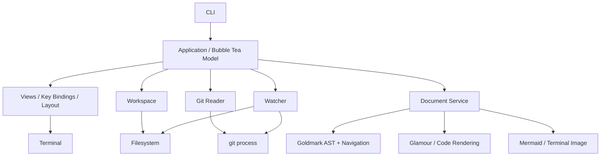

# Terminal Workspace Explorer — 基本設計書

- Status: Draft / P1 実装前の設計基準（P0 の検証結果を反映済み）
- Version: 0.2
- Date: 2026-10-12
- Language: Go
- UI: Bubble Tea v2
- Project / executable name: `replor`（リポジトリ名と同じ）
- Related: [ROADMAP.md](ROADMAP.md), [ADR-0001 P0 技術 Spike の採否](../../adr/0001-p0-technical-spike.md)

## 1. 背景と目的

GitHub（個人開発）とAzure DevOps（業務）では、リポジトリやWikiを閲覧する際のWeb UI・ナビゲーションが異なる。一方、ローカルのファイル、Markdown、ソースコード、Git変更は、ホスティングサービスに依存しない共通の情報である。

gh-miniの「ディレクトリを開いて、ファイル・README・Git差分を簡単に読む」体験を参考に、ターミナルで同じ操作体系を提供する。GitHubの画面・URL構造を再現すること自体は目的としない。

### 1.1 プロダクトステートメント

> 任意のローカルディレクトリ／Git worktreeで起動し、ファイル、ドキュメント、ローカルGit変更を一貫したキーボード操作で探索・閲覧できる、プロバイダー非依存のTerminal Workspace Explorer。

### 1.2 原則

1. **Local-first**: ネットワーク・GitHub/Azure DevOps認証がなくても主機能を使える。
2. **File-first**: 起動直後はファイルツリーとプレビュー。ダッシュボードを初期画面にしない。
3. **Read-only**: 初期リリースでGitやファイルを書き換えない。
4. **Provider-agnostic**: Git remoteのホスト名によってローカル閲覧体験を変えない。
5. **Terminal-native**: Webサーバー・Chromium・Node.jsを通常利用の必須要件にしない。
6. **Graceful degradation**: Mermaid/画像非対応端末では、ソース表示またはテキスト表示へフォールバックする。
7. **Minimal architecture**: 単一Goモジュール・単一プロセス。不要なプラグイン機構・永続DB・DIコンテナは作らない。

## 2. スコープ

### 2.1 初期製品（v1）の対象

| 区分 | 機能 | 詳細 |
|---|---|---|
| Workspace | ディレクトリ／ファイル指定起動 | Git管理外でも起動。任意のworktreeを個別Workspaceとして扱う |
| Navigation | ツリー、ファイル絞り込み、履歴 | ツリー開閉、ファジーファイル検索、前後移動、TOC |
| Preview | Markdown・コード・テキスト | GFM、構文ハイライト、Preview/Sourceの切替 |
| Links | 相対リンク・見出しアンカー | Workspace内の`.md`リンクと`#anchor`を解決。外部URLは明示的操作で開く |
| Git | Status・Diff・変更ファイル抽出 | staged / unstaged / untracked / deleted / renamed / conflicted を区別 |
| Git | 分岐元からの差分 | 基準ブランチとmerge-baseを用いた比較。デフォルトの自動fetchなし |
| Wiki | Azure DevOps Wiki構造 | `.order`を用いたページ順、TOC指定、Mermaidコンテナー、添付画像・リンク |
| Render | 画像・Mermaid | サポート端末で表示し、未対応時はソース表示へフォールバック |
| Reactivity | ファイル・Git更新追従 | 変更を検知し、選択・スクロール位置を可能な限り保持 |
| Distribution | macOS（保証）／ Linux（CI で動作確認）／ WSL（ベストエフォート） | ローカルインストール可能な実行ファイル |

**MVPとv1は分ける**。MVPはファイル／Git／GFMの実用最小構成。Azure WikiとMermaidを含むv1で初期製品構想を完成させる（詳細はROADMAP）。

### 2.2 明示的な対象外（v1）

- GitHub/Azure DevOpsのPRレビュー詳細、Issue・Work Item、CI・Pipeline取得
- PR作成・承認・コメント・マージ、Git commit/push/stageなどの書き込み操作
- GitHubのWebデザインの再現、CSSテーマの完全再現、数式組版の完全互換
- 任意HTML・JavaScriptのブラウザ実行プレビュー
- エディタ、言語サーバー、コードインテリジェンス、全文索引DB
- 複数リポジトリ／worktreeの同時管理や同期
- gh-miniの言語別Markdown並列比較、印刷、アバターなどの付加機能

これらは「採用しない」と確定したわけではなく、v1の完了条件に含めない。

## 3. 主要ユースケース

1. `replor .`で起動し、READMEや設計文書を閲覧する。
2. ツリー／ファイルファインダーから任意のソースコードへ移動する。
3. MarkdownのTOCと相対リンクをたどり、元の表示位置へ戻る。
4. 現在の未コミット変更からファイルを選択しDiffを確認する。
5. 機能ブランチについて、分岐元からの累積差分（コミット済み＋未コミット）を確認する。
6. Azure Wikiの`.order`順序でページを閲覧し、Mermaidと画像を確認する。
7. Ghostty/macOSで閲覧する。画像表示が非対応の端末（Windows Terminal/WSL を含む）でも同じキー操作で読める（WSL はベストエフォート、12.2）。

## 4. UX設計

### 4.1 情報アーキテクチャ

```text
┌────────────────────────────────────────────────────────────────┐
│ workspace-name   branch-name   M:2 A:1     [Files] [Changes]  │
├──────────────────────┬─────────────────────────────────────────┤
│ EXPLORER             │ README.md      [Preview] [Source] [Diff]│
│ ▾ docs/              │                                         │
│   overview.md        │ # Project                               │
│   design.md       M  │ Documentation ...                       │
│ ▾ src/               │                                         │
│   main.go            │ ┌──────── Mermaid / Code ────────────┐  │
│   parser.go       A  │ └────────────────────────────────────┘  │
├──────────────────────┴─────────────────────────────────────────┤
│ f files  / search  t TOC  d Diff  Tab focus  Enter open       │
└────────────────────────────────────────────────────────────────┘
```

- デフォルトは**ツリー＋閲覧ペイン**。READMEを持つディレクトリでは、そのREADMEをプレビュー候補にする。
- FilesとChangesは対等な入口だが、起動直後はFilesに固定。
- Git statusのマークは常時ツリーに表示。Changes専用画面に隔離しない。
- 選択したファイルでPreview / Source / Diffを切り替える。表示できないタブは提供しない。
- ターミナル幅が狭い場合、サイドバーを自動で隠して単一ペインとし、ショートカットで切り替える。
- 読み取り中、認識不能、未対応、エラーは異なる表示状態にする。

### 4.2 キー操作（初期案）

| キー | 動作 |
|---|---|
| `j/k`, `↑/↓` | リスト移動・本文スクロール |
| `h/l`, `←/→` | ツリーを閉じる／開く |
| `Tab` | ツリーと本文のフォーカス切替 |
| `Enter` | 選択ファイル、検索結果、リンク、TOC項目を開く |
| `>` / `<` | 文書内の次／前のリンクを選択（選択中に `Enter` で遷移） |
| `f` | ファイルファインダー |
| `/` | 表示中の文書内検索 |
| `n/N` | 文書内検索の次／前の一致へ移動 |
| `t` | 見出し一覧（TOC） |
| `d` | 表示中ファイルの Diff を unstaged → staged の順に表示し、最後に Preview へ戻る（変更のないファイルでは無効） |
| `s` | PreviewとSourceの切替（Markdownのみ。閲覧位置はソース行で引き継ぐ） |
| `e` | ファイルツリーの表示／非表示 |
| `i` | Gitが無視する未追跡ファイルの表示／非表示（ツリーとファインダー共通。既定は非表示） |
| `c` | 左ペインの Files と Changes の切替。Changes は Conflicts / Staged / Unstaged / Untracked に分けて並べ、`Enter` で Diff を開く |
| `b` | Changes 内の Working と Branch の切替（P1-08） |
| `Backspace` | 履歴を戻る |
| `]` | 履歴を進む |
| `r` | ファイル一覧・現在の文書・Git情報を明示的に再取得 |
| `o` | 明示的に外部ブラウザでURLを開く |
| `?` | ヘルプ |
| `q`, `Esc` | 現在のモードを閉じる／ルートでは終了 |

操作キーは**モードとフォーカスに応じて衝突しない**ように定義する。入力中の文字をグローバルショートカットで奪わない。曖昧なキーは実装前にUXテストで確定する。

### 4.3 ナビゲーションの状態

- 履歴要素 = ファイルパス／表示モード／アンカーまたはスクロール位置／選択リンク。
- リサイズ時にはファイルと意味上の閲覧位置を優先して維持（単純な画面行数ではなくアンカー等を使う）。
- ファイルが削除された場合は「削除済み」を明示し、Gitの履歴からDiffを見られるなら案内する。
- ディレクトリツリーはフィルタ設定に関係なく、現在の選択対象を復元できる。
- 戻った後に新しい対象を開いた場合は、進む履歴を破棄する。履歴復元でも現在の読み取り境界を適用する。
- 文書内検索は、現在のPreviewまたはSourceの描画後プレーンテキストに対するリテラル検索（大文字小文字を区別しない）とし、画像内の文字は対象外。検索語の入力、確定、キャンセル、次／前への移動を提供する。一致は描画行からブロック位置（8.1）へ変換して保持する。
- 閲覧位置は「画面先頭」だけでなく、注目対象（検索一致・選択リンク・ジャンプ先見出し）も保持し、リサイズ後に注目対象が画面内に残るよう復元する。
- リンクの選択はブロック単位で示す（ガターの印＋ステータス行にリンク文字列と遷移先）。行内のハイライトは行わない。

## 5. システム構成

### 5.1 論理構成



1つのGoプロセス内で上記責務を分離する。TUIコンポーネントから`git`や`os.ReadFile`を直接呼ばない。Applicationが非同期コマンドを起動し、結果メッセージを受け取る。

### 5.2 パッケージ構成（初期案）

```text
cmd/replor/main.go
internal/
  app/              # Bubble Tea Model / Msg / Cmd、画面遷移
  ui/               # tree, viewport, finder, changes, help
  workspace/        # workspace discovery, tree, file metadata, filtering
  git/              # status, refs, merge-base, diffs（read-only）
  document/         # markdown parser, AST, anchors, links, wiki dialect
  preview/          # markdown/code/text, mermaid, image presentation
  watch/            # filesystem & git invalidation
  process/          # git等のCommandContext実行とtimeout
  config/           # CLI options / XDG config
  testutil/         # fixture helpers（必要になったら）
testdata/
  markdown/
  azure-wiki/
  git/
  mermaid/
go.mod
go.sum
```

**設計規律**: インターフェースはテスト差し替えや不安定な外部依存の境界に限定する。`repository`、`service`、`ports`などの薄い転送層を機械的に増やさない。

### 5.3 技術選定

| 用途 | 選定 | 確定度 |
|---|---|---|
| TUI | `charm.land/bubbletea/v2` | 確定 |
| UI部品 | `charm.land/bubbles/v2` | 確定（必要な部品だけ使う） |
| スタイル | `charm.land/lipgloss/v2` | 確定。本文を含むペインの横結合には使わない（4.1・8.1） |
| Markdown AST | `github.com/yuin/goldmark`（GFM + Footnote） | 確定 |
| ANSI Markdown表示 | `charm.land/glamour/v2`（ブロック単位で呼ぶ） | 確定 |
| コードハイライト | `github.com/alecthomas/chroma/v2`（Glamour経由。Sourceでも同じものを使う） | 確定 |
| ファイル監視 | 標準ライブラリの stat による定期確認（`internal/watch`） | 確定（D-14）。fsnotify は不採用 |
| Mermaid | `github.com/zkrebbekx/go-mermaid`（SVG）＋ raster の内製版（CJKフォールバック） | **条件付き採用**（8.3） |
| ターミナル画像 | 内製（Kitty Unicode placeholder／halfblocks は `x/mosaic`） | 確定。`go-termimg` は不採用 |
| Git | `git` CLI / `os/exec`、最低 2.31 | 確定 |
| 設定 | Go標準＋必要時のみTOML | 方針確定 |

依存の版は go.mod でロックする（go directive は依存の要求により 1.26.0）。全依存は MIT または BSD 系で、CGo は不要（ADR-0001 3.8）。新しい依存を足すときは、ライセンス・CGo の要否・更新状況を記録する。

## 6. Workspaceとファイル操作

### 6.1 起動と境界

- `replor [PATH]`。PATH省略時はカレントディレクトリ。単一ファイルも受け付け、親ディレクトリをWorkspaceの起点にして指定ファイルを選択。
- Gitリポジトリ外でもファイル閲覧は可能。Git機能を非表示またはUnavailableとして表示。
- 指定ディレクトリ（ファイル指定なら親）をWorkspace rootとし、表示rootと読み取り境界を一致させる。起動時にrootを解決・固定し、その配下からのシンボリックリンクによる境界外参照は拒否する。
- Git rootはWorkspaceを含むリポジトリのrootとして別に保持する。Changes・件数・ファイル検索はWorkspace内に限定し、パスをGit root基準へ変換する。境界をまたぐrenameは範囲内側だけを閲覧可能にし、他方は範囲外と表示する。
- `replor docs/`から`../README.md`は開かず、理由とリポジトリrootから起動する方法を表示する。リンク、履歴、画像から読み取り境界を自動拡大しない。
- Wiki rootはroot-relativeリンクの解決基準として別に保持する。v1ではAzure WikiモードのWorkspace rootをWiki rootとし、公開Wikiのサブフォルダはそのフォルダを指定して起動する。部分的なフォルダ起動ではWiki全体のリンク互換を保証しない。
- ファイルアクセスはすべて `os.Root` 経由で行う。`os.Root` はルート内を指していても絶対パスの symlink を辿らないため、v1 ではこれを「辿れない symlink」として理由付きで表示する。Git管理ディレクトリがworktreeの外側にあるケースはGit CLIを通じて扱う。
- バイナリ・巨大ファイルはサイズ／種類を判定し、全文読み込みを避ける。Markdown Preview は 1 MiB まで（超えたら Source 表示に切り替えて理由を出す）、Source 表示の読み取りは 8 MiB まで（超えたら「大きすぎる」と表示）。

### 6.2 ファイル一覧・検索

- ツリーには通常ファイルとディレクトリを表示し、`.git`等の内部管理対象は表示しない。
- Git管理下ではGitのignore判定を利用し、未追跡の無視ファイルを標準では隠す。追跡済みファイルはignoreパターンに一致しても表示する。Git管理外またはGit機能が利用不能な場合はignore評価を行わず、その状態を表示する。
- 無視ファイルの表示はツリーとファインダーで共通に切り替える。明示指定したファイルと履歴の選択対象は境界内なら表示し、無視対象なら印を付ける。削除済みファイルはChangesで扱う。
- ディレクトリを展開したタイミングで必要な範囲だけ列挙。巨大ツリーの全展開は制限する。
- ファイル検索はパスに対するファジーマッチとし、Workspace全体の全文検索は対象外。ツリー展開とは独立した非同期列挙で、未展開ディレクトリを含むパス一覧をメモリ上に構築する。
- 列挙中は得られた候補と「列挙中」を表示する。件数（20万件）・深さ（64）の上限到達時は検索結果が部分的であることを示す。検索語変更で列挙を再起動せず、Workspaceやフィルタ変更で旧列挙をキャンセルする。symlink は列挙するが辿らない（循環しない）。
- Wikiの`.order`は**Wiki表示順序**に作用し、Git status・通常のファイルツリーの真実を変更しない。

## 7. Git情報モデル

### 7.1 二つの差分軸を分離する

| モード | 意味 | 代表的なGit操作 |
|---|---|---|
| **Working Changes** | HEAD以降の未コミット変更 | `git status --porcelain=v2 -z`, `git diff`, `git diff --cached` |
| **Branch Changes** | 分岐元から現在の作業ツリーまでの累積変更 | `git merge-base BASE HEAD`, `git diff MERGE_BASE` + untracked統合 |

Branch Changesでは、分岐後のコミット済み変更と未コミット変更を一体で見せる。未追跡ファイルはGit Diffでは表示されないため別途取得する。

| 表示 | 左側 → 右側 | 変更一覧の生成元 |
|---|---|---|
| Working / staged | HEAD → Index | statusのIndex側とcached diff |
| Working / unstaged | Index → Working tree | statusのWorking tree側とdiff |
| Branch | 固定したmerge-base OID → Working tree | 基準からのdiff固有の一覧。Working statusから流用しない |
| Untracked | 空 → 現在のファイル | statusから取得し、Workingの独立した未追跡区分とBranch一覧へ統合。stagedには含めない |

- 同一パスのstagedとunstagedは別の差分として保持する。Branchは最終的な純差分であり、コミット済み変更を作業ツリーで打ち消した場合は一覧から消え得る。操作履歴の一覧ではない。
- untracked統合時はパスで照合する。Branchの基準に存在したパスが現在untrackedの場合は基準内容との比較を優先し、空ファイルからの追加を重複表示しない。ignoredは変更一覧へ自動統合しない。
- 初回コミット前のstagedは空のtreeとの比較とし、BranchはUnavailable。detached HEADでもOIDで比較可能なら提供する。
- 基準不明、merge-baseなし／複数、shallow履歴不足、オブジェクト不足は理由付きUnavailableとし、任意の基準へ代替しない。
- conflictは通常の二者diffへ混ぜず、未解決として表示し作業ファイルのSourceを提供する。v1ではIndex各stageの比較UIは対象外。
- submoduleはgitlinkのOID変更だけを表示する。dirty状態は、submodule固有のfilter設定で外部プログラムが実行され得るため v1 では取得しない（`--ignore-submodules=dirty`）。内部差分の再帰閲覧や自動初期化は行わない。

- 基準ブランチは設定値優先。未指定時は`refs/remotes/origin/HEAD`等のローカル参照から解決し、候補がなければ「比較基準なし」と表示。
- Git remoteを自動fetchせず、ローカル参照時点の結果であることを表示。
- working treeを直接変更するGitコマンドは実行しない。
- staged / unstaged / untracked / ignored / conflicted / deleted / renamedを混同しない。
- 削除済みファイルもChangesビューから参照できる。名前変更には旧パス・新パスを保持。
- Gitが存在しない／コマンド失敗／非Gitディレクトリを個別の状態として扱う。

### 7.2 スナップショットモデル（概念）

```go
type DiffScope string

const (
    DiffStaged   DiffScope = "staged"
    DiffUnstaged DiffScope = "unstaged"
    DiffBranch   DiffScope = "branch"
)

type GitSnapshot struct {
    Revision      uint64
    HeadOID       string
    Branch        string
    BaseRef       string
    BaseOID       string
    MergeBaseOID  string
    Status        []FileChange
    Comparisons   map[DiffScope]Comparison
    State         GitState
    Stale         bool
}
```

`FileChange`はIndex側／Working tree側の状態、旧・新パス、untracked/conflict/submoduleの区別を保持する。`Comparison`は比較元・先、独立した変更一覧、Ready/Unavailable/Errorと理由を持つ。`GitState`は非Git、Git非導入、取得失敗、取得成功を区別する。

Gitの状態は非同期に読み取り、完成したスナップショットだけをUIへ反映する。複数CLI呼び出しは原子的ではないため、HEAD・基準OIDと取得中の変更通知を照合し、不一致ならStaleとして再取得する。diff結果にもSnapshot revisionを付け、一覧と異なるrevisionの結果を表示しない。連続更新中は再試行を制限し、更新待ち状態と明示更新を提供する。

### 7.3 Gitプロセスの実行契約

すべての Git 呼び出しは `internal/git` を通す。根拠となった実測は ADR-0001 3.3。

| 経路 | 契約 |
|---|---|
| Index・参照の書き換え | `--no-optional-locks`、`GIT_OPTIONAL_LOCKS=0`、`-c diff.autoRefreshIndex=false`（`git diff` は stat だけ変わったファイルがあると optional locks に関係なく index を書き戻すため。git 2.50.1 で確認）。working tree を変更するコマンドは呼ばない。stat だけの変更を内容の変更と区別するときは `git hash-object`（`-w` なし）で作業ファイルを読む |
| fsmonitor hook | `-c core.fsmonitor=false` |
| filter driver（clean/smudge/process） | 設定済みの driver 名を Git 呼び出しのたびに列挙し直し、`GIT_CONFIG_COUNT` 経由で clean/smudge/process を空、required を false にする（起動後に追加された driver も無効化するため、結果をキャッシュしない） |
| 外部diff・textconv | diff 系の呼び出しには `--no-ext-diff --no-textconv` を必ず付ける |
| 署名検証 | `-c log.showSignature=false` |
| pager | `--no-pager`、`GIT_PAGER=cat`、`PAGER=cat` |
| lazy fetch | 2.45 以上は `--no-lazy-fetch`。2.45 未満で partial clone の場合は Git 機能を Unavailable にする |
| 対話認証 | `GIT_TERMINAL_PROMPT=0` |
| 環境変数 | 許可リスト（PATH, HOME, USER, LOGNAME, XDG_CONFIG_HOME, TMPDIR, SYSTEMROOT）だけを引き継ぎ、`GIT_*`・`*_ASKPASS` 等は落とす。`LC_ALL=C` |
| パス | `--literal-pathspecs`、オプション境界 `--`。機械処理は `-z` |
| 出力 | `-c core.quotePath=false`、`-c color.ui=false` |
| 資源 | 1 呼び出しあたり timeout 10s・出力 64 MiB。リポジトリごとに直列実行 |

- ユーザーの Git 設定（global の excludesFile など）は読むが、上表の項目はプロセス単位で上書きする。ユーザー設定ファイルは書き換えない。
- 最低対応 Git は 2.31（`GIT_CONFIG_COUNT` が必要）、partial clone は 2.45。要件を満たさない Git、所有者の異なるリポジトリ（`safe.directory`）、Git 非導入は理由を表示して Git 機能を無効化し、ファイル閲覧は継続する。
- status はリポジトリ全体を取得し、Workspace 外のパスは変換時に範囲外として扱う。pathspec で絞ると境界をまたぐ rename の対応が失われるため。

## 8. Markdown・Azure Wiki・画像

### 8.1 文書パイプライン

```text
bytes → Goldmark AST (+ dialect extensions)
                  ├→ navigation index (headings / anchors / links / source offsets)
                  ├→ terminal rendering (Glamour initially)
                  └→ Mermaid / image blocks → terminal display or source fallback
```

- AST・見出し・リンクを正式な文書構造として保持。**ANSI文字列だけを文書モデルにしない**。
- 描画方式: トップレベルブロックをソース位置順に並べ、各ブロックを Glamour で個別に描画する（全参照定義を各ブロックに付ける）。描画結果はブロックごとの開始行を持ち、閲覧位置は「ブロック＋ブロック内の行オフセット」で表す。幅の変更では同じブロック位置へ戻す。
- 入力は描画前に `document.Sanitize` を通す（11.9）。Glamour が出力する OSC 8 ハイパーリンクは http/https 以外を除去する（11.3）。
- Glamour が扱えない構文は、自前の AST から検出してブロックを差し替える。GitHub Alert はラベル付き引用、脚注は定義の一覧として表示する。ローカルリンクの URL 併記は行わない。
- 横に並べるペインは行ごとに切り詰めて合成する。絵文字の幅は端末の幅方式（wcwidth / grapheme）で変わるため、表の完全な整列は保証せず、画面幅を超えないことだけを保証する。
- PreviewとSourceは同じ入力ファイルに紐づく。Sourceでは行番号とコードハイライトを表示する。
- 相対リンクは現在の文書基準で解決し、パス逸脱は禁止。`#anchor`は文書内の見出しIDと照合する。
- 見出しIDは github-slugger 互換（小文字化、文字・数字・`_`・`-`・空白以外を除去、空白を `-`、重複に `-1` 以降）で、見出しの Markdown ソースではなく描画後のテキスト（リンク・強調・コードの記法を除いたもの）から作る。goldmark の自動 ID はソースから作られ、非 ASCII も落とすため使わない。Azure Wiki固有のアンカー差は明示的に扱う。
- HTMLは原則として安全な文字列または対応要素の簡易表現として表示し、JavaScriptを実行しない。

### 8.2 Azure DevOps Wiki対応

| 対象 | 方針 |
|---|---|
| `.order` | 該当フォルダのページ順を再現するWikiナビゲーション |
| `[[_TOC_]]` | 生成TOCへ対応付ける。位置・サポート範囲を検証 |
| `[[_TOSP_]]` | ページ階層から子ページ一覧を生成。文書内見出しTOCとは分離 |
| `::: mermaid` | 標準のMermaidブロックに正規化 |
| `mermaid`フェンス形式 | 標準Mermaidブロックとして扱う |
| Attachments / images | ローカル相対パスを解決し、存在しない場合はリンク表示 |
| Wiki内部リンク | ローカルへ解決できるものは開く。Webページ専用のリンクは外部へ委譲 |

Markdown方言はGit remoteでは自動決定しない。`auto / gfm / azure-wiki`を指定できるようにし、`.order`やWiki固有構文などからの自動認識は保守的に行う。

- Wikiナビゲーションは`Page.md`と`Page/`を同一ページの本文と子ページ集合として扱う。本文のないディレクトリは階層ノードとして表示し、通常のFilesツリーは実ファイル構造を保つ。
- `.order`の有効な最初の出現順を採用し、重複と欠損参照は診断表示する。未記載ページはファイル名順で末尾へ追加する。`.order`がなければ同じ名前順を使う。
- 相対リンクは文書基準、先頭`/`のWikiリンクはWiki root基準で解決する。拡張子なしのページリンク、`.attachments`、日本語、空白・ハイフン、percent encodingをfixture化する（`testdata/azure-wiki`）。URIをパスとfragmentに分け、パスを一度だけデコードした後に境界を検証する。拡張子なしのリンクは `Page.md` を優先し、同名ファイルとの曖昧さはエラーにする。曖昧な候補は推測で開かない。
- Azure がページ名からファイル名を作るときの変換（空白 → `-`、`:` などの percent encoding）とリンクの対応は P2-03 で確定する。それまでは推測せず「見つからない」とする。
- TOSPは直接の子ページをWiki順で表示する。ページ追加・削除・改名と`.order`更新は、親ページのTOSPを含む関連ナビゲーション・描画キャッシュを無効化する。
- Workspace内の階層とリンクfixtureをP0で作り、P2で方言の互換範囲を完成させる。業務文書をfixturesへ流用せず、構造を再現した合成データを使う。

**互換性方針**: Azure DevOpsの公式Web表示とピクセルレベルの一致は目指さない。文書の意味、ナビゲーション、図表の読みやすさを優先する。

### 8.3 Mermaidと画像表示

- Mermaid は `go-mermaid` で SVG を生成し、PNG 化は raster パッケージの内製版で行う。upstream の raster はラベルを Go フォント固定で描くため、日本語が豆腐になる。内製版では日本語を含むラベルを OS のフォントへフォールバックする（macOS: ヒラギノ、Linux: Noto CJK）。フォントは同梱しない。
- 最低限の図種は `flowchart/graph`, `sequenceDiagram`, `erDiagram`。円柱ノードの円弧の崩れと、日本語ラベルの幅の見積もりずれは既知制約として扱い、upstream に報告する。
- 非対応・生成エラー・CJK フォント不在のときは、Mermaidソースとエラー種別をブロック単位で表示し、文書全体の表示を停止させない。
- 表示方式は `kitty / halfblocks / off` の 3 つ。判定は環境変数だけで行う（端末への問い合わせは Bubble Tea の入力読み取りと競合するため）。

| 条件 | 方式 |
|---|---|
| `KITTY_WINDOW_ID`、`TERM=xterm-kitty` / `xterm-ghostty`、`TERM_PROGRAM=ghostty`（tmux 内を除く） | kitty |
| `TMUX`、`COLORTERM=truecolor` / `24bit`、`WT_SESSION` | halfblocks |
| それ以外 | off（ソース・代替テキスト） |

- Kitty: 画像データは `tea.Raw` で 1 回だけ転送して仮想配置を作り、本文には Unicode placeholder（U+10EEEE＋行・列の diacritics）を文字として置く。スクロール・クリップ・差分描画はテキストと同じ扱いになる。画像 ID は 24bit 未満とし、文書の切替・リサイズ・終了時に削除する。1 画像は最大 64×64 セル。
- halfblocks: `x/mosaic` で指定セル数ちょうどの色付き `▀` 行を生成する。
- Sixel・iTerm2 は v1 の対象外。セル単位の差分描画の外で書き込む必要があり、スクロール時のクリップと消去を自前で管理することになるため。
- セルの縦横比は 1:2 と仮定する。セルのピクセル寸法の取得は P2-04 で扱う。
- 画像キャッシュキーはソース内容、図種、レンダラー設定、利用可能な表示幅に依存する。ファイル更新時には関連部分のみ無効化。

## 9. 非同期処理・更新

### 9.1 イベントモデル

```text
File/Git event or user action
          ↓
Debounce / Invalidate
          ↓
Async IO (context timeout)
          ↓
Result message (+ generation / request ID / target revision)
          ↓
Apply if still current
          ↓
Render new View
```

- `Update`と`View`内で長いI/Oを実行しない。
- Workspace/Branch切り替え時に**generation ID**を更新する。加えて表示先ごとのrequest ID、対象パス、内容revision、表示モード・幅・テーマ・方言を要求と結果に対応付け、現在の要求と一致する結果だけ反映する。
- 同一WorkspaceのA→B選択、同一ファイルの再編集、リサイズの前後で完了順が逆転しても、古い結果は現在の表示を上書きしない。不要な要求はキャンセルし、キャンセル不能でも結果を棄却する。
- 同時実行は、描画が表示先ごとに 1 件（新しい要求が古い要求をキャンセル）、Git がリポジトリごとに直列、パス列挙が 1 件。同じ表示先への要求は `app.Latest` で最新のものへ集約し、古い結果は完了しても棄却する。プロセスのtimeoutに加え、CPU処理の入力サイズ（6.1の上限）も制限する。
- 変更の検出は 1 秒ごとの stat 比較で行う（D-14）。対象は表示中のファイル、ルートと展開中のディレクトリ（エントリは `.git` を除き、1 回の走査で合計 5000 件まで）、Git の index・HEAD・MERGE_HEAD・packed-refs・現在のブランチの ref・`reftable/tables.list`。走査は前回の結果を受け取ってから次を予約するので重ならない。
- 比較の基準は、読み込み・一覧・Git の読み取りの直前に取った stat とする。読み込みと次の走査の間に起きた変化も検出できる。mtime が 2 秒以内のエントリは、同じ mtime・同じサイズの書き換えがあり得るため、次の走査でも変化ありとみなす（Git の racily clean と同じ考え方）。
- 変化があれば Git の状態を読み直す。表示中のファイルは、先頭ブロックの内容と選択中のリンクで位置を引き継いで読み直す。ディレクトリの一覧は、名前が増減したときだけ、展開中のサブツリーを残したまま読み直す。ファインダーの列挙結果は破棄する（開いている間は破棄せず、次に開いたときに再走査する）。表示中の Diff は新しいスナップショットで読み直す。
- 監視による Git・表示の読み直しは、実行中のものをキャンセルせず、完了後に 1 回だけ実行する。書き込みが続いても読み取りが完了しないことを防ぐため。`r` は実行中のものを取り消して読み直す。
- Worktreeの`.git`がファイルになることに対応。worktree 固有の管理ディレクトリ（index・HEAD）と共通管理ディレクトリ（参照）を `git rev-parse --path-format=absolute` で解決する。
- 変更通知は完全とはみなさない。未展開のディレクトリ内の編集は検出しない。エントリの上限に達したときはヘッダーに「watch partial」と出す。どの場合も `r` で再取得できる。`--no-watch` で監視を止められる。
- 表示中のファイルが消えたら、表示済みだった場合か Git が変更として報告している場合に「削除済み」と出し、Diff があれば `d` を案内する（4.3）。
- 端末幅変更時、再レイアウト後も閲覧位置をできるだけ保持する。

### 9.2 キャッシュ

| 項目 | 方針 |
|---|---|
| ファイルツリー | メモリ上のSnapshot、無効化による更新 |
| Markdown AST | 内容ハッシュ＋方言・パーサー設定で再利用 |
| 表示済みMarkdown | AST＋文書パス・解決root＋幅＋テーマ＋関連画像・Wiki階層revisionで再利用 |
| Mermaid | ソース＋描画設定の結果をセッション内に保持 |
| Git | 明示更新・変更通知による再取得 |

初期版ではSQLiteやディスクキャッシュを使用しない。

キャッシュは総バイト数とエントリ数に上限を設け、未使用の項目から破棄する。描画済み Markdown は合計 64 MiB かつ 16 件の LRU とする（描画結果は元文書の約 9 倍になる。ADR-0001 3.5）。Linux CI での再計測でも据え置きとした。

## 10. CLIと設定

```sh
replor                 # カレントディレクトリ
replor .               # 指定ディレクトリ
replor docs/           # サブディレクトリ
replor README.md       # 指定ファイルを選択して起動
replor --flavor azure-wiki
replor --images off    # auto（既定）/ kitty / halfblocks / off
replor --no-watch
```

- オプションは必要になったものだけ実装し、設定のための設定を増やさない。
- 設定ゼロで起動。設定ファイルが必要になればXDG_CONFIG_HOME（未設定ならプラットフォーム既定）を利用。
- `--offline`は将来Remote Contextを追加したときに意味を持つため、v1では必須にしない。
- CGo 不要の単一バイナリで配布する。`CGO_ENABLED=0` で darwin/linux × amd64/arm64 をビルドできることを確認済み（Linux 版の起動は CI で確認済み）。実行時に必要なのは `git`（任意）と、Mermaid の日本語表示用の OS フォントだけ。

## 11. セキュリティ・信頼境界

1. Markdown/HTML/外部コードを**実行しない**。コードブロックはデータとして扱う。
2. 対象パスはWorkspace境界で検証し、シンボリックリンク・相対パス・URIからの逸脱を防ぐ。
3. 外部ブラウザへの委譲は明示操作された`https`/`http` URLだけに限定する。`file`、`javascript`、`data`、任意アプリ用スキーム、プロトコル相対URL、制御文字を含むURLは拒否する。端末のクリックで開ける OSC 8 ハイパーリンクも http/https だけを残す（Glamour は任意のスキームに OSC 8 を付けるため）。外部画像・SVG参照を含め、表示だけでネットワーク接続しない。
4. `git`呼び出しは`exec.CommandContext`で引数を分離し、シェル経由で組み立てない。
5. Git情報取得には7.3の実行契約を適用し、対応できない環境ではGit機能を無効化する。
6. ログには全文ファイル内容、URL中の認証情報、秘密情報を記録しない。
7. 巨大ファイル、循環リンク、深すぎるツリー、異常に長い行、画像解凍によるメモリ消費を制限する。
8. Git remote等から外部サービスへ自動接続しない。初期版にGitHub/Azure DevOpsの認証処理はない。
9. 本文、ファイル名、Git出力、エラーに含まれる入力由来の端末制御文字を、描画前に可視化・無害化する。許可する改行・タブは表示コンテキストごとに定義し、ANSI・画像制御シーケンスは信頼するレンダラーだけが生成する。Source表示にも同じ境界を適用する。

## 12. 品質・テスト方針

### 12.1 自動テスト

| レベル | 重点 |
|---|---|
| Unit | パス解決、アンカー、`.order`、ファイル絞り込み、状態遷移 |
| Integration | `git init`した一時リポジトリでstatus/diff/worktree/rename/delete |
| Golden | GFM、Azure Wiki、日本語・Unicode、複雑な表、ANSI出力 |
| Regression | 非同期結果の順序逆転、幅変更、検索・履歴復元、watch無効化、監視欠落、エラー復旧 |
| Security | symlink逸脱、パス走査、巨大ファイル、端末制御文字、不許可URL、Git副作用・外部実行・自動通信の抑止 |
| UI (headless) | Bubble Tea の Model を `Update`/`View` で直接駆動し、リサイズ・フォーカス・リンク・履歴・TOC・検索・古い結果の棄却・画像行を検証。全行が wcwidth と grapheme の両方式で画面幅に収まることを検査 |
| Load | `REPLOR_LOAD=1` で有効化する計測テスト（列挙・描画・Git status） |
| Manual | Ghostty（Kitty と halfblocks）での画像・Mermaid のクリップ・スクロール・消去、絵文字の幅 |

### 12.2 対象環境

- macOS + Ghostty（優先）
- Linux（CI の Ubuntu ランナーで build・test・起動を確認）
- Linux on WSL2 + Windows Terminal（ベストエフォート。検証環境がないため、Linux として動くことだけを保証し、Windows Terminal での表示は既知制約として扱う）
- その他一般的な端末（TTY機能不足時のフォールバック）
- Git非導入、Git管理外、ネットワークなしでも正常に劣化すること

### 12.3 品質ゲート

- `go fmt ./...`（差分チェック）、`go vet ./...`、`go test ./...`
- 該当環境で`go test -race ./...`
- 配布バイナリを利用した実機スモークテスト
- 性能は初回PoCで測定し、大きなWorkspaceでも操作ブロックしないことを合格基準にする。未測定の数値SLOは定義しない。

## 13. 設計判断（ADR候補）

| ID | 判断 | 根拠 |
|---|---|---|
| D-01 | Go / Bubble Tea v2 | 開発・配布・非同期状態管理の単純さ |
| D-02 | File-first TUI | gh-miniの簡潔な閲覧フローを継承 |
| D-03 | Local-first + read-only | 安全で高速な起動、プロバイダー非依存性 |
| D-04 | Git CLIを使用 | worktreeやGit indexの既存仕様を活用 |
| D-05 | GitHub/ADO remote adapterをv1に実装しない | ローカル共通UXを先に完成させる |
| D-06 | ASTと描画結果を分離 | リンク・TOC・アンカーへの拡張を確保 |
| D-07 | Mermaid/画像は段階的採用とフォールバック | 品質・配布リスクが残るため |
| D-08 | モジュラーモノリス | 初期保守コストを抑える |
| D-09 | Glamour をブロック単位で描画し AST 索引と対応付け | リンク・TOC・検索・リサイズ復元が成立し、一括描画比の追加コストは約 10%（ADR-0001） |
| D-10 | Git 実行契約（7.3）と最低 Git 2.31 | 素の status/diff が hook・filter・external diff を実行し index を書き換えることを実測（ADR-0001） |
| D-11 | 画像は Kitty placeholder / halfblocks / off、Sixel は対象外 | セル単位の差分描画の中で扱えるのは placeholder とテキストだけ（ADR-0001） |
| D-12 | Mermaid は go-mermaid＋raster の内製版（CJK フォールバック） | upstream の PNG 化は日本語非対応（ADR-0001） |
| D-13 | Diff は内製の unified ビューア（`git diff` の出力を無害化して色分け）。untracked は Workspace 境界内でファイルを読んで追加として組み立てる | 外部ツール（delta 等）への委譲は外部実行を抑止する Git 実行契約（7.3）と相容れない |
| D-14 | ファイル監視は stat による定期確認（1 秒、表示中の対象と Git の管理ファイルだけ） | fsnotify は macOS の kqueue でファイルごとに fd を消費し、inotify は監視数の上限があり、ネットワーク系 FS（WSL の `/mnt/c` など）では通知が来ない。表示中の対象に絞れば stat は軽く、どの FS でも同じに動く |

## 14. 未決定事項と検証条件

P0 で決定した事項は ADR-0001 に記録した。残りは次のとおり。

| 未決定 | 判断条件 | 期限 |
|---|---|---|
| Windows Terminal + WSL | 表示（halfblocks・絵文字幅）と `/mnt/c` 上の性能。ベストエフォートのため v1 の完了条件に含めない。Windows 環境を確保できたときに確認する | P3-02（任意） |
| Mermaid の日本語 | raster 内製版＋OS フォント探索で 3 図種の日本語が読める。CJK フォントがない Linux での表示を決める | P2-04 |
| Wiki内部リンクの互換範囲 | Azure のファイル名変換とリンクの対応を合成 fixture で確定 | P2-03 |
| remote情報の統合 | v1利用から実需が確認できた場合のみ着手 | v1後 |

## 15. 参照資料

- gh-mini: https://github.com/babarot/gh-mini
- gh-mini Changes: https://github.com/babarot/gh-mini/blob/main/docs/guides/changes.md
- Bubble Tea v2: https://github.com/charmbracelet/bubbletea
- Bubble Tea v2 Upgrade Guide: https://github.com/charmbracelet/bubbletea/blob/main/UPGRADE_GUIDE_V2.md
- Glamour v2: https://github.com/charmbracelet/glamour
- Azure Wiki Markdown: https://learn.microsoft.com/azure/devops/project/wiki/markdown-guidance
- Azure Wiki file structure: https://learn.microsoft.com/azure/devops/project/wiki/wiki-file-structure
- Mermaid (Go候補): https://github.com/zkrebbekx/go-mermaid
- Terminal images (Go候補): https://github.com/blacktop/go-termimg
- Git process options: https://git-scm.com/docs/git
- Git diff / textconv: https://git-scm.com/docs/git-diff
- Git configuration / fsmonitor: https://git-scm.com/docs/git-config
- Azure Wiki Markdown source (TOSP): https://github.com/MicrosoftDocs/azure-devops-docs/blob/main/docs/project/wiki/markdown-guidance.md
