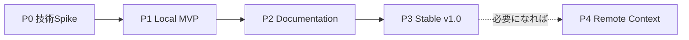

# Terminal Workspace Explorer — 開発ロードマップ

- Status: Proposed（P0 完了。次は P1 の実装計画）
- Version: 0.2
- Date: 2026-10-12
- Product name: `replor`（実行ファイル名も同じ）
- Related: [DESIGN.md](DESIGN.md), [ADR-0001 P0 技術 Spike の採否](../../adr/0001-p0-technical-spike.md)

## 1. ロードマップ方針

**まず「gh-miniのローカル閲覧価値を持つTUI」を完成させる。GitHub / Azure DevOpsのオンライン統合は、別の意思決定として扱う。**

- 優先順位: **Core（Files + Git）→ Documentation（GFM + Azure Wiki）→ 品質・配布 → 任意のRemote Context**。
- v0.xは技術検証とMVP、**v1.0はCore + Documentationの完成**を表す。
- カレンダー上の実装期限は設定しない。フェーズの完了条件を満たした時点で次へ進む。
- 課題は、実装方法を強制せず**スコープ・期待結果・受け入れ条件**を中心に定義する。
- 変更対象のワークスペースは読み取り専用。Remote Contextのためにv1のリリースを遅延させない。

## 2. リリースマップ

| 段階 | 到達点 | ユーザーができること | 成果物 |
|---|---|---|---|
| **P0 — 技術Spike** | Go TUIの成立性確認 | 仮の2ペインでMarkdown、図、画像を試す | PoC・採否の記録 |
| **P1 — Local MVP** | ファイル＋Gitビューア | ツリー/検索、Markdown/コード、Status/Diff、変更追跡 | `v0.1` |
| **P2 — Documentation** | GitHub / Azure Wikiを共通閲覧 | TOC、リンク、Wiki順序、Mermaid、画像 | `v0.2` |
| **P3 — Release Hardening** | 日常利用できる安定版 | macOS で安定更新・インストール。Linux は CI で動作確認、WSL はベストエフォート | `v1.0` |
| **P4 — Optional Context** | 必要な時だけオンライン拡張 | PR/レビュー/CI/関連Workを閲覧 | v1.x以降、要再判断 |

## 3. P0 — 技術Spike（最優先）

目的: **Go固有の不確実性を、本格実装に入る前に下げる。**

| ID | 作業項目 | スコープ・期待結果 | 受け入れ条件 |
|---|---|---|---|
| P0-01 | Bubble Tea v2の最小TUI | ディレクトリツリーとMarkdownプレビューを2ペインに配置 | リサイズ・フォーカス・カーソル移動で表示が破綻しない |
| P0-02 | GFMと日本語の表示評価 | テーブル、Task List、Alert、脚注、日本語長文・全角/絵文字を比較 | 最低限の読みやすさと問題ケースを記録し、回避策を定義 |
| P0-03 | AST・リンク・TOC評価 | ASTと描画位置の対応、検索、リンク・TOC・履歴 | リンク選択→遷移→戻る、TOC・検索一致への移動、リサイズ後の位置復元が成立。P1で使う描画方式を決定 |
| P0-04 | Mermaid画像生成評価 | Goのみで3図種（graph/sequence/ER）、日本語ラベルを描画 | 品質・失敗モード・未対応構文・依存/ライセンスを記録 |
| P0-05 | ターミナル画像統合評価 | 画像を本文内に挿入し、スクロール・リサイズ・消去を行う | GhosttyとWSL/Windows Terminalで結果を記録、fallback動作を確認 |
| P0-06 | 配布可能性の検証 | macOS/Linux用バイナリを生成 | 実行時にNode/Chromium/開発用Goを要求せず起動する。CGo要否を記録 |
| P0-08 | 境界・Git実行契約 | Workspace/Git/Wiki root、Wiki階層の合成fixtures、Git副作用の抑止 | サブディレクトリ起動・範囲外リンク・renameの扱い、最低対応Git版、Index更新・外部実行・lazy fetch抑止を確定 |
| P0-09 | 非同期・負荷評価 | 完了順の逆転、キャンセル、大量パス・巨大文書・連続選択 | request ID/revisionで古い結果を棄却。列挙・処理・キャッシュの上限と同時実行数を決定 |
| P0-07 | 技術選定の決裁 | 主要レンダラーを継続・変更・延期から選ぶ | P0-01〜06・08・09の結果から、描画方式・実行契約・上限・採否・残課題をADRに明記 |

**P0ゲート:** 文書ナビゲーションと検索・位置復元が成立し、描画方式・境界・Git実行契約・負荷上限が確定している。Mermaid/画像について「実装方式＋フォールバック」が明確になっている。フル画像対応が不安定なら画像機能を切り離してP1へ進めてよいが、v1要件に残すかは明示する。

### 3.1 P0 の結果（2026-10-12）

詳細と根拠は ADR-0001。「未確認」は sandbox で pty・実端末・Linux を使えず、自動化できなかったもの。

| ID | 結果 | 残り |
|---|---|---|
| P0-01 | 完了（ヘッドレスと Ghostty）。リサイズ・フォーカス・カーソル・狭幅で画面幅を超えない | — |
| P0-02 | 完了。Alert と脚注は Glamour 非対応、絵文字の幅は端末依存。回避策を P1-04 に追加 | — |
| P0-03 | 完了。ブロック単位描画＋AST 索引を採用し、リンク・戻る/進む・TOC・検索・リサイズ復元が成立 | — |
| P0-04 | 条件付き採用。go-mermaid の SVG は 3 図種とも可。PNG は日本語が豆腐になり、フォントのフォールバックで解消できることを試作で確認 | P2-04 で raster を内製化 |
| P0-05 | 完了。Kitty placeholder / halfblocks / off を採用し、ヘッドレスと Ghostty で確認 | Windows Terminal は任意（P3-02） |
| P0-06 | CGo 不要で 4 ターゲットをビルドでき、Linux 版の起動も CI で確認した | — |
| P0-08 | 完了。境界・Git 実行契約・最低 Git 2.31（partial clone は 2.45）・Wiki fixture | — （CI の Git 2.43.0 でも通過） |
| P0-09 | 完了。上限と同時実行数を決定し、Linux CI でも再計測した | — |
| P0-07 | ADR-0001 を作成し、Ghostty での確認結果を追記 | — |

**ゲート判定: 通過（2026-10-12）。** 描画方式・境界・Git 実行契約・上限・Mermaid/画像の方式とフォールバックが確定し、Ghostty での手動確認（ADR-0001 5章）も問題なく完了した。Linux 固有の確認は P1-00 の CI で完了した。Windows Terminal + WSL はベストエフォートとし、任意項目の P3-02 で扱う。

## 4. P1 — Local MVP（v0.1）

目的: **ネットワークなしでも実用的なローカルRepository Explorerを提供する。**

| ID | 作業項目 | スコープ | 受け入れ条件 | 依存 |
|---|---|---|---|---|
| P1-00 | 基本CI（完了） | Go build、fmt差分検査、vet、test、Linux 固有の確認 | P1の最初からmacOS/Linuxで実行でき、以後の結合テストを継続実行する。Linux では `ubuntu:24.04` コンテナの同梱 Git でも `internal/git` のテストが通り、`CGO_ENABLED=0` のバイナリが起動し、`REPLOR_LOAD=1` の計測結果を ADR-0001 3.5 に追記する | P0-07 |
| P1-01 | CLI起動とWorkspace検出 | `replor [PATH]`、Git管理外、ファイル指定、worktree | 各条件で正常起動。サブディレクトリ境界とsymlink逸脱拒否を検証 | P0-01, P0-08 |
| P1-02 | ファイルツリー | 階層表示、折りたたみ、ignoreの扱い | 追跡済み・無視・明示指定・削除を区別し、巨大ディレクトリでも上限内で操作できる。ディレクトリ列挙も非同期 | P1-01 |
| P1-03 | ファイルファインダー | 独立した非同期パス列挙、ファジー検索、Enterで開く | 未展開ディレクトリも検索可能。列挙中・部分結果（20万件・深さ 64）を明示し、フィルタ変更で旧列挙を破棄 | P1-02 |
| P1-04 | テキスト／コードプレビュー | Markdown Preview/Source、テキスト/ソース、構文ハイライト、GitHub Alert と脚注の表示、大きな文書での表示範囲からの先行描画（1MiB で 2.4 秒かかる環境がある） | 日本語・長い行・空・巨大（Preview 1 MiB / Source 8 MiB）・バイナリを扱い、本文・名前・エラーの端末制御文字を無害化。http/https 以外の OSC 8 を除去し、ローカルリンクの URL を併記しない。選択／編集／幅変更の順序逆転で誤表示しない | P1-01, P0-02, P0-03, P0-09 |
| P1-05 | 基本ナビゲーション | フォーカス、戻る/進む履歴、文書内検索と次/前、Help、ペイン切替、リンク選択キーの確定 | 検索一致と閲覧位置を復元でき、リサイズ後も注目対象（一致・選択リンク）が画面内に残る。進む履歴の破棄、入力中のキー分離、読み込みエラー後の履歴・リンク・検索操作を検証 | P1-02, P1-04 |
| P1-06 | Git Status | staged/unstaged/untracked/ignored/rename/delete/conflict、submodule の gitlink 変更 | 状態・NUL区切りの特殊名・境界内件数がfixtureと一致。Git非導入・2.31 未満・2.45 未満の partial clone・`safe.directory`・非Gitを区別し、副作用抑止（DESIGN 7.3）を検証 | P1-01, P0-08 |
| P1-07 | ChangesビューとDiff | 変更一覧、ファイル別unified diff、staged/unstaged切替 | 同一パスのstaged/unstaged、初回コミット前、削除、conflict、submoduleを設計7.1どおり表示。一覧とdiffのrevisionが一致 | P1-06 |
| P1-08 | Branch Changes | merge-baseからの差分、基準ブランチ設定 | 独立したBranch一覧で純差分とuntrackedを重複なく表示。変更の打ち消し・detached HEAD・基準不明・shallow履歴不足・オブジェクト不足を検証し、自動通信しない | P1-07, P1-09 |
| P1-09 | ファイル監視 | 編集/作成/削除、Git状態変化、明示更新`r` | 更新・選択位置維持、worktree共通参照の変更を検証。監視無効・欠落・上限到達でも`r`で復帰し、古い結果を棄却 | P1-02, P1-06 |
| P1-10 | ローカル結合テスト | 通常repo、worktree、非Git、ディレクトリ指定、複雑なGit状態 | 境界・端末制御文字・Git副作用・非同期競合の回帰テストがCIで通る。OS依存テストを分離 | P1-00〜09 |

**P1 の進捗**

| ID | 状態 |
|---|---|
| P1-00 | 完了 |
| P1-01 | 完了（worktree の確認は P1-10） |
| P1-02 | 完了。無視ファイルは既定で隠し `i` で表示（ツリーとファインダー共通）。追跡済みファイルはパターンに一致しても表示する |
| P1-03 | 完了。列挙中の結果表示・部分結果（20万件・深さ 64）・`r` での再列挙。ファジー検索は内製（`internal/fuzzy`、20万件で約 20ms、非同期） |
| P1-04 | 完了 |
| P1-05 | 完了 |
| P1-06 | 完了。ツリーの状態マーク・変更を含むディレクトリの印・ヘッダーのブランチと件数・Git なし/使用不可の表示 |
| P1-07 | 完了。Changes ペイン（`c`）、Diff（`d`）、同一パスの staged / unstaged、初回コミット前、削除、rename（境界をまたぐ場合を含む）、conflict（作業ファイルを表示）、submodule、一覧と diff の revision 照合 |
| P1-09 | 完了。stat による定期確認（D-14）、表示中ファイル・展開中ディレクトリ・Git の管理ファイル（worktree 対応）、閲覧位置とカーソルの保持、削除済みの表示、監視上限の表示、`--no-watch` |
| P1-08 | 完了。Changes 内の `b` で Working と Branch を切替（Files からは Branch を開く）。基準は `--base` → `refs/remotes/origin/HEAD` の順で、最初に Branch を開いたときから取得する。純差分と untracked の統合（基準にあり現在 untracked のパスは 1 件で基準内容と比較）、打ち消し、detached HEAD、基準なし・merge-base なし／複数・shallow・オブジェクト不足の理由表示、基準 ref の監視。fetch はしない |
| P1-10 | 未着手 |

**P1完了条件（MVP Definition of Done）**

- `replor .`だけで起動し、README・コードを選択して読める。
- キー操作だけでファイル検索・文書内検索と次/前・プレビュー・Diff・戻る/進む操作を行える。
- Git statusと分岐元との差分が整合し、非Gitフォルダでも閲覧できる。
- ファイル更新時、UIを起動し直さず再表示でき、監視無効時も`r`で更新できる。連続操作や完了順の逆転で別の内容を表示しない。
- ネットワーク、認証、Webサーバーは不要。
- 境界逸脱・端末制御文字・Git副作用のテストと標準品質チェック（build/fmt/vet/test）がCIで成功する。

## 5. P2 — Documentation（v0.2）

目的: **Markdown中心の作業をGitHubとAzure DevOpsで共通化する。**

| ID | 作業項目 | スコープ | 受け入れ条件 | 依存 |
|---|---|---|---|---|
| P2-01 | Markdown TOCとAnchor | 見出し一覧、文書内ジャンプ、前の位置への復帰 | 日本語見出し・重複見出し・GFMアンカーfixtureを通る | P0-03, P1-05 |
| P2-02 | Markdownリンクナビゲーション | 相対ファイルリンク、同一文書内リンク、外部URL | ローカルは境界内で開き、外部は明示操作のhttp/httpsのみ。デコード後の逸脱・不許可スキーム・制御文字を拒否 | P2-01 |
| P2-03 | Azure Wiki方言 | TOC、TOSP子ページ一覧、Wikiページ階層・リンク・`.order`、Mermaidコンテナー、ページ名とファイル名の変換 | 合成fixtures（`testdata/azure-wiki`）で本文と子階層、未記載/重複/欠損の順序、拡張子なし・root-relative・エンコード済みリンク、空白 → `-`・`%3A` のファイル名を検証 | P2-02, P0-08 |
| P2-04 | Markdown図・画像 | Mermaidのgraph/sequence/ER（raster 内製版＋CJK フォント探索）、一般画像、Kitty placeholder / halfblocks / off、セルのピクセル寸法 | 日本語ラベルが読める。フォント不在・非対応画像環境でも文書を読める。生成エラーを局所表示。文書切替・終了時に Kitty 画像を消去 | P0-04, P0-05 |
| P2-05 | レイアウト品質 | テーブル・コードブロック・日本語の幅/折り返し | 端末幅変更で表示破綻しない、Viewportが操作可能 | P1-04, P2-04 |
| P2-06 | ドキュメント更新追従 | 文書・画像・Wiki階層の更新とキャッシュ破棄 | ページ追加/削除/改名・`.order`変更で親のTOSPも更新。上限内でキャッシュを破棄し、閲覧位置を可能な範囲で維持 | P1-09, P2-03, P2-04 |
| P2-07 | 差異のドキュメント化 | GFM/Azure WikiとWeb版の非互換範囲 | 対応構文一覧・既知制約・フォールバックがREADMEに記載 | P2-03〜05 |

**P2ゲート:** 同じ操作でGitHub READMEとAzure Wikiの文書を読める。対応外のHTML/図表があっても、全体の閲覧が止まらない。画像表示の可否が端末依存であることを明示。

## 6. P3 — Release Hardening（v1.0）

目的: **毎日使える品質と、企業PCを含む配布・運用の予測可能性を確保する。**

| ID | 作業項目 | スコープ | 受け入れ条件 | 依存 |
|---|---|---|---|---|
| P3-01 | macOS実機検証 | Ghostty、ターミナル画像・色・キー操作 | ファイル/差分/日本語/画像の確認結果を残す | P2 |
| P3-02 | WSL実機検証（任意） | Ubuntu on WSL2 + Windows Terminal | Windows 環境を確保できた場合だけ実施する。同じ基本キー操作で使用でき、画像非対応時はfallback。`/mnt/c` 上の Workspace で列挙と status の性能を計測する。v1.0 の判定には含めない | P2 |
| P3-03 | 異常系・大規模Workspace | 大量ファイル、深い階層、壊れたリンク、Gitエラー、巨大文書 | 操作不能やクラッシュにならず、エラーと復帰手段がある | P1, P2 |
| P3-04 | セキュリティ境界の総合検証 | P1/P2で追加済みの境界・端末出力・Git・URL・画像の検証 | 配布構成でもWorkspace外の閲覧・意図しない実行・自動通信を防ぐ回帰テストが通る | P1, P2 |
| P3-05 | 配布・リリース | 基本CIに成果物生成・バージョン表示・配布物スモークテストを追加 | macOS/Linux成果物をクリーン環境で生成・実行でき、開発ランタイム不要 | P0-06, P1-00 |
| P3-06 | ドキュメント整備 | README、インストール、操作、制約、設定、Troubleshooting | 初見利用者がゼロ設定で閲覧を開始できる。WSL がベストエフォートであることを明記する | P3-01, P3-03〜05 |
| P3-07 | v1.0リリース判定 | 完了条件と残存既知制約の確認 | 重大障害0、必須対応項目の完了、既知制約の明記 | P3-01, P3-03〜06 |

## 7. P4 — Optional Context（v1後の検討候補）

P4は**現時点での実装コミットメントではない**。v1の利用体験を観察して必要性を評価する。

| 候補 | 提供価値 | 着手判断の条件 |
|---|---|---|
| P4-A: PRサマリー | 現在のブランチのPR状態をTUIで参照 | GitHubとAzure DevOpsで同じ操作が必要と確認できたとき |
| P4-B: CI概要 | PRに関係するChecks/Build Validationを一覧 | 単純なpipeline runとPRポリシーを取り違えないモデルができたとき |
| P4-C: Work Item / Issue | 変更の目的・作業項目へナビゲーション | 「現在のWorkspaceに関連する情報」に絞れるとき |
| P4-D: 言語別ドキュメント | `.ja.md`などの切替・並列表示 | 実際の利用頻度とUI需要が確認できたとき |
| P4-E: 外部ビューア連携 | ブラウザ品質が必要なHTML/数式などへ委譲 | TUIで扱えないコンテンツが実用上の障害となったとき |

リモート機能を導入する場合は、認証を独自実装する前に`gh` / `az` CLIの既存認証を利用する。GitHub / Azure DevOpsの**情報取得失敗と、対象情報が存在しない状態**は必ず区別する。

## 8. 推奨の実装順序と依存関係

P1内は基本CIと境界を先に整備し、Files・Working Changes・更新追従を成立させてからBranch Changesを統合する。Branch ChangesはMVPの完了条件に残す。安全性と負荷制限は各機能の実装時に検証し、P3では配布構成で再確認する。

クリティカルパスは次のとおり。

1. **P0-03** ASTと画面ナビゲーションの整合性。P1前に描画方式を確定し、P2への先送りを避ける。
2. **P0-05** Mermaid・画像表示とViewportの統合。Go TUIの最大の実装リスク。
3. **P1-06/07/08** Git statusとdiff scopeの整合性。gh-mini級の変更閲覧品質に直結する。
4. **P2-03** Azure Wiki固有のリンク・ページ順序。GitHub/Azure DevOps統一という価値に直結する。
5. **P3-01** macOS（Ghostty）での実機評価。WSL/Windows Terminal はベストエフォートのため、クリティカルパスに含めない。

## 9. 共通のDefinition of Done

各作業項目は、完了時に以下の条件を満たす。

- スコープに記載した利用シナリオを実際に操作できる。
- 必要なUnit/Integrationテストが追加される。
- `go fmt ./...`, `go vet ./...`, `go test ./...`が通る。
- 未対応条件・エラー時・オフライン時の挙動を定義する。
- 新しい外部依存がある場合、採用理由、ライセンス、配布への影響を記録する。
- キー操作を追加した場合、Helpと操作ドキュメントを同期する。
- セキュリティ上のI/O境界に影響する場合、悪意のある入力を含むテストを行う。

## 10. 評価指標（KPI候補）

数値は実測後に設定する。根拠のない性能目標を置かない。

| 分野 | 計測するもの | 意図 |
|---|---|---|
| 起動 | 指定Workspaceから最初の画面までの時間 | 快適なCLI体験 |
| 操作感 | ファイル選択からプレビュー表示までの時間 | Git/Markdown処理でUIを止めない |
| Git | 状態更新の時間・コマンド回数 | 大きなリポジトリでの性能劣化防止 |
| 表示 | 日本語表・リンク・画像・図の成功率 | 表示品質の実態を捉える |
| 携帯性 | macOS でのインストール・動作結果、Linux CI の結果 | 同一ツールによる開発体験統一 |
| メンテナンス | 追加依存、独自レンダラーのコード量 | 長期の保守負担を抑える |

## 11. 次の着手作業

1. P1 の具体的な実装計画を確定する。P1-00（基本 CI）は完了している（`Makefile`・`.github/workflows/ci.yml`・`docs/development.md`）。
2. `spike/mermaid` は P2-04 着手時に削除する（`spike/tui` は P1 で削除済み）。
