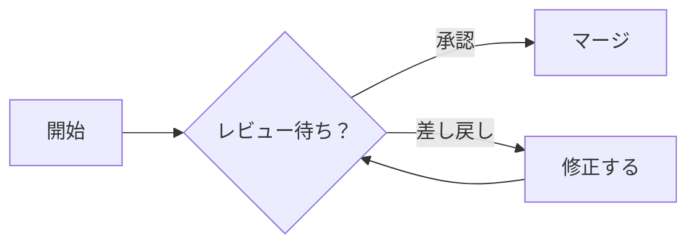
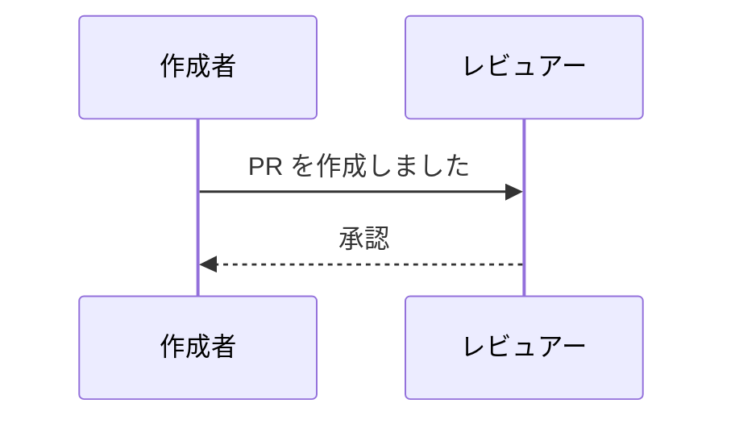
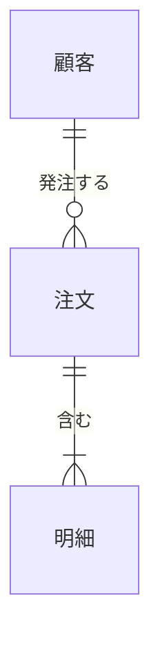

# スクロール確認用の長い文書（P0 Spike S1）

図と画像が画面の上下端をまたぐように、間に段落を挟んでいる。`j` / `k` で 1 行ずつ、`Space` / `b` で 1 画面ずつ動かす。

## 区間 1

1. 日本語の段落です。スクロールで図が画面の上端・下端にかかったときに、画像の残骸が出ないかを確かめるための埋め草の文章です。
2. 日本語の段落です。スクロールで図が画面の上端・下端にかかったときに、画像の残骸が出ないかを確かめるための埋め草の文章です。
3. 日本語の段落です。スクロールで図が画面の上端・下端にかかったときに、画像の残骸が出ないかを確かめるための埋め草の文章です。
4. 日本語の段落です。スクロールで図が画面の上端・下端にかかったときに、画像の残骸が出ないかを確かめるための埋め草の文章です。
5. 日本語の段落です。スクロールで図が画面の上端・下端にかかったときに、画像の残骸が出ないかを確かめるための埋め草の文章です。
6. 日本語の段落です。スクロールで図が画面の上端・下端にかかったときに、画像の残骸が出ないかを確かめるための埋め草の文章です。
7. 日本語の段落です。スクロールで図が画面の上端・下端にかかったときに、画像の残骸が出ないかを確かめるための埋め草の文章です。
8. 日本語の段落です。スクロールで図が画面の上端・下端にかかったときに、画像の残骸が出ないかを確かめるための埋め草の文章です。
9. 日本語の段落です。スクロールで図が画面の上端・下端にかかったときに、画像の残骸が出ないかを確かめるための埋め草の文章です。
10. 日本語の段落です。スクロールで図が画面の上端・下端にかかったときに、画像の残骸が出ないかを確かめるための埋め草の文章です。
11. 日本語の段落です。スクロールで図が画面の上端・下端にかかったときに、画像の残骸が出ないかを確かめるための埋め草の文章です。
12. 日本語の段落です。スクロールで図が画面の上端・下端にかかったときに、画像の残骸が出ないかを確かめるための埋め草の文章です。

## 区間 2

1. 日本語の段落です。スクロールで図が画面の上端・下端にかかったときに、画像の残骸が出ないかを確かめるための埋め草の文章です。
2. 日本語の段落です。スクロールで図が画面の上端・下端にかかったときに、画像の残骸が出ないかを確かめるための埋め草の文章です。
3. 日本語の段落です。スクロールで図が画面の上端・下端にかかったときに、画像の残骸が出ないかを確かめるための埋め草の文章です。
4. 日本語の段落です。スクロールで図が画面の上端・下端にかかったときに、画像の残骸が出ないかを確かめるための埋め草の文章です。
5. 日本語の段落です。スクロールで図が画面の上端・下端にかかったときに、画像の残骸が出ないかを確かめるための埋め草の文章です。
6. 日本語の段落です。スクロールで図が画面の上端・下端にかかったときに、画像の残骸が出ないかを確かめるための埋め草の文章です。
7. 日本語の段落です。スクロールで図が画面の上端・下端にかかったときに、画像の残骸が出ないかを確かめるための埋め草の文章です。
8. 日本語の段落です。スクロールで図が画面の上端・下端にかかったときに、画像の残骸が出ないかを確かめるための埋め草の文章です。
9. 日本語の段落です。スクロールで図が画面の上端・下端にかかったときに、画像の残骸が出ないかを確かめるための埋め草の文章です。
10. 日本語の段落です。スクロールで図が画面の上端・下端にかかったときに、画像の残骸が出ないかを確かめるための埋め草の文章です。
11. 日本語の段落です。スクロールで図が画面の上端・下端にかかったときに、画像の残骸が出ないかを確かめるための埋め草の文章です。
12. 日本語の段落です。スクロールで図が画面の上端・下端にかかったときに、画像の残骸が出ないかを確かめるための埋め草の文章です。

## 区間 3

1. 日本語の段落です。スクロールで図が画面の上端・下端にかかったときに、画像の残骸が出ないかを確かめるための埋め草の文章です。
2. 日本語の段落です。スクロールで図が画面の上端・下端にかかったときに、画像の残骸が出ないかを確かめるための埋め草の文章です。
3. 日本語の段落です。スクロールで図が画面の上端・下端にかかったときに、画像の残骸が出ないかを確かめるための埋め草の文章です。
4. 日本語の段落です。スクロールで図が画面の上端・下端にかかったときに、画像の残骸が出ないかを確かめるための埋め草の文章です。
5. 日本語の段落です。スクロールで図が画面の上端・下端にかかったときに、画像の残骸が出ないかを確かめるための埋め草の文章です。
6. 日本語の段落です。スクロールで図が画面の上端・下端にかかったときに、画像の残骸が出ないかを確かめるための埋め草の文章です。
7. 日本語の段落です。スクロールで図が画面の上端・下端にかかったときに、画像の残骸が出ないかを確かめるための埋め草の文章です。
8. 日本語の段落です。スクロールで図が画面の上端・下端にかかったときに、画像の残骸が出ないかを確かめるための埋め草の文章です。
9. 日本語の段落です。スクロールで図が画面の上端・下端にかかったときに、画像の残骸が出ないかを確かめるための埋め草の文章です。
10. 日本語の段落です。スクロールで図が画面の上端・下端にかかったときに、画像の残骸が出ないかを確かめるための埋め草の文章です。
11. 日本語の段落です。スクロールで図が画面の上端・下端にかかったときに、画像の残骸が出ないかを確かめるための埋め草の文章です。
12. 日本語の段落です。スクロールで図が画面の上端・下端にかかったときに、画像の残骸が出ないかを確かめるための埋め草の文章です。

## 区間 4

1. 日本語の段落です。スクロールで図が画面の上端・下端にかかったときに、画像の残骸が出ないかを確かめるための埋め草の文章です。
2. 日本語の段落です。スクロールで図が画面の上端・下端にかかったときに、画像の残骸が出ないかを確かめるための埋め草の文章です。
3. 日本語の段落です。スクロールで図が画面の上端・下端にかかったときに、画像の残骸が出ないかを確かめるための埋め草の文章です。
4. 日本語の段落です。スクロールで図が画面の上端・下端にかかったときに、画像の残骸が出ないかを確かめるための埋め草の文章です。
5. 日本語の段落です。スクロールで図が画面の上端・下端にかかったときに、画像の残骸が出ないかを確かめるための埋め草の文章です。
6. 日本語の段落です。スクロールで図が画面の上端・下端にかかったときに、画像の残骸が出ないかを確かめるための埋め草の文章です。
7. 日本語の段落です。スクロールで図が画面の上端・下端にかかったときに、画像の残骸が出ないかを確かめるための埋め草の文章です。
8. 日本語の段落です。スクロールで図が画面の上端・下端にかかったときに、画像の残骸が出ないかを確かめるための埋め草の文章です。
9. 日本語の段落です。スクロールで図が画面の上端・下端にかかったときに、画像の残骸が出ないかを確かめるための埋め草の文章です。
10. 日本語の段落です。スクロールで図が画面の上端・下端にかかったときに、画像の残骸が出ないかを確かめるための埋め草の文章です。
11. 日本語の段落です。スクロールで図が画面の上端・下端にかかったときに、画像の残骸が出ないかを確かめるための埋め草の文章です。
12. 日本語の段落です。スクロールで図が画面の上端・下端にかかったときに、画像の残骸が出ないかを確かめるための埋め草の文章です。

## 末尾

1. 日本語の段落です。スクロールで図が画面の上端・下端にかかったときに、画像の残骸が出ないかを確かめるための埋め草の文章です。
2. 日本語の段落です。スクロールで図が画面の上端・下端にかかったときに、画像の残骸が出ないかを確かめるための埋め草の文章です。
3. 日本語の段落です。スクロールで図が画面の上端・下端にかかったときに、画像の残骸が出ないかを確かめるための埋め草の文章です。
4. 日本語の段落です。スクロールで図が画面の上端・下端にかかったときに、画像の残骸が出ないかを確かめるための埋め草の文章です。
5. 日本語の段落です。スクロールで図が画面の上端・下端にかかったときに、画像の残骸が出ないかを確かめるための埋め草の文章です。
6. 日本語の段落です。スクロールで図が画面の上端・下端にかかったときに、画像の残骸が出ないかを確かめるための埋め草の文章です。
7. 日本語の段落です。スクロールで図が画面の上端・下端にかかったときに、画像の残骸が出ないかを確かめるための埋め草の文章です。
8. 日本語の段落です。スクロールで図が画面の上端・下端にかかったときに、画像の残骸が出ないかを確かめるための埋め草の文章です。
9. 日本語の段落です。スクロールで図が画面の上端・下端にかかったときに、画像の残骸が出ないかを確かめるための埋め草の文章です。
10. 日本語の段落です。スクロールで図が画面の上端・下端にかかったときに、画像の残骸が出ないかを確かめるための埋め草の文章です。
11. 日本語の段落です。スクロールで図が画面の上端・下端にかかったときに、画像の残骸が出ないかを確かめるための埋め草の文章です。
12. 日本語の段落です。スクロールで図が画面の上端・下端にかかったときに、画像の残骸が出ないかを確かめるための埋め草の文章です。
13. 日本語の段落です。スクロールで図が画面の上端・下端にかかったときに、画像の残骸が出ないかを確かめるための埋め草の文章です。
14. 日本語の段落です。スクロールで図が画面の上端・下端にかかったときに、画像の残骸が出ないかを確かめるための埋め草の文章です。
15. 日本語の段落です。スクロールで図が画面の上端・下端にかかったときに、画像の残骸が出ないかを確かめるための埋め草の文章です。
16. 日本語の段落です。スクロールで図が画面の上端・下端にかかったときに、画像の残骸が出ないかを確かめるための埋め草の文章です。
17. 日本語の段落です。スクロールで図が画面の上端・下端にかかったときに、画像の残骸が出ないかを確かめるための埋め草の文章です。
18. 日本語の段落です。スクロールで図が画面の上端・下端にかかったときに、画像の残骸が出ないかを確かめるための埋め草の文章です。
19. 日本語の段落です。スクロールで図が画面の上端・下端にかかったときに、画像の残骸が出ないかを確かめるための埋め草の文章です。
20. 日本語の段落です。スクロールで図が画面の上端・下端にかかったときに、画像の残骸が出ないかを確かめるための埋め草の文章です。
21. 日本語の段落です。スクロールで図が画面の上端・下端にかかったときに、画像の残骸が出ないかを確かめるための埋め草の文章です。
22. 日本語の段落です。スクロールで図が画面の上端・下端にかかったときに、画像の残骸が出ないかを確かめるための埋め草の文章です。
23. 日本語の段落です。スクロールで図が画面の上端・下端にかかったときに、画像の残骸が出ないかを確かめるための埋め草の文章です。
24. 日本語の段落です。スクロールで図が画面の上端・下端にかかったときに、画像の残骸が出ないかを確かめるための埋め草の文章です。
25. 日本語の段落です。スクロールで図が画面の上端・下端にかかったときに、画像の残骸が出ないかを確かめるための埋め草の文章です。
26. 日本語の段落です。スクロールで図が画面の上端・下端にかかったときに、画像の残骸が出ないかを確かめるための埋め草の文章です。
27. 日本語の段落です。スクロールで図が画面の上端・下端にかかったときに、画像の残骸が出ないかを確かめるための埋め草の文章です。
28. 日本語の段落です。スクロールで図が画面の上端・下端にかかったときに、画像の残骸が出ないかを確かめるための埋め草の文章です。
29. 日本語の段落です。スクロールで図が画面の上端・下端にかかったときに、画像の残骸が出ないかを確かめるための埋め草の文章です。
30. 日本語の段落です。スクロールで図が画面の上端・下端にかかったときに、画像の残骸が出ないかを確かめるための埋め草の文章です。
