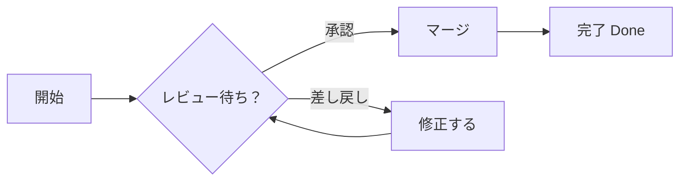
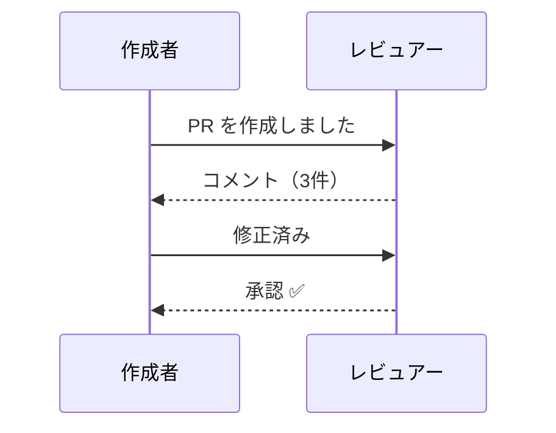
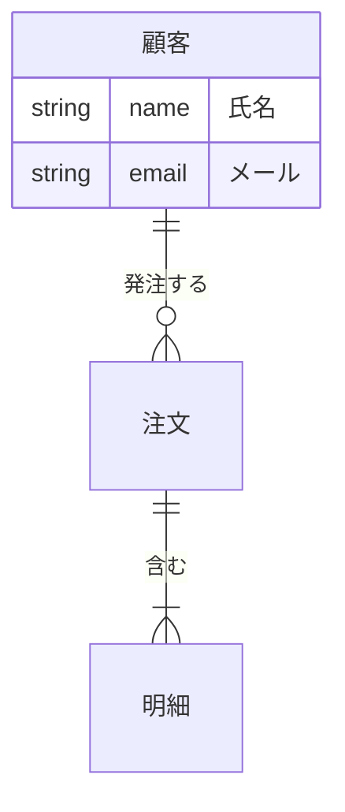
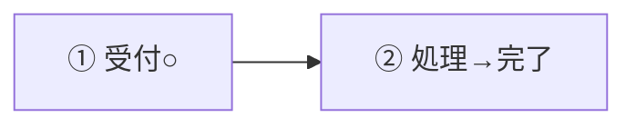

# 日本語ラベルの Mermaid（P0 Spike S1・S2）

## flowchart

## sequenceDiagram

## erDiagram

## Azure Wiki 形式

::: mermaid
graph TD
  W[Wiki ページ] --> X[添付画像 .attachments]
  W --> Y[子ページ]
:::

## 曖昧幅の文字（○・①・→）

